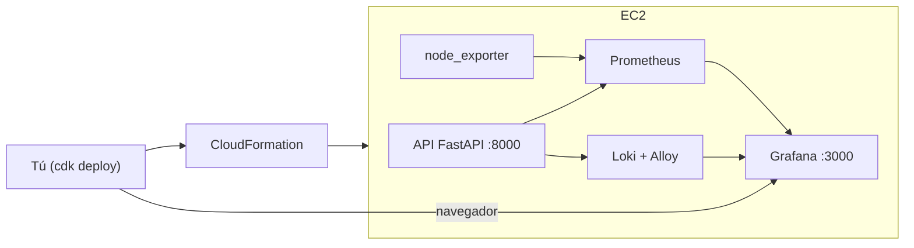

# Parte 1 — Métricas y Logs (CDK + Grafana)

Despliegas todo en AWS con **un solo comando de CDK**. La EC2 arranca sola e instala
Docker con todos los servicios (API, Prometheus, Loki, Grafana, node_exporter). Tú solo
entras a Grafana y creas dos dashboards: **CPU** y **respuestas de la API**.

> La Parte 2 (trazas con OpenTelemetry y Jaeger) está en
> [`02-trazas-distribuidas-opentelemetry-jaeger.md`](./02-trazas-distribuidas-opentelemetry-jaeger.md)
> y usa la **misma** instancia (no vuelves a desplegar).

---

## 1. Arquitectura (resumen)



Solo **Grafana (3000)** y la **API (8000)** se exponen a tu IP. El resto queda interno.

---

## 2. Requisitos previos

- **AWS CLI** con el perfil `stay` configurado (`aws sts get-caller-identity --profile stay`).
- **Node.js** y el CDK CLI: `npm install -g aws-cdk` (comprueba con `cdk --version`).
- **Python 3.12+**.

---

## 3. Desplegar con CDK

Desde la carpeta `cdk/`:

```bash
cd cdk
python3 -m venv .venv && source .venv/bin/activate
pip install -r requirements.txt

# Solo la primera vez en la cuenta/región:
cdk bootstrap --profile stay

# Despliega limitando el acceso a TU IP pública:
cdk deploy --profile stay -c allowedCidr=$(curl -s https://checkip.amazonaws.com)/32 --require-approval never
```

**Resultado esperado:** al terminar (~3 min) CDK imprime las *Outputs*, entre ellas:

```
ObsLabStack.GrafanaUrl = http://<IP-PUBLICA>:3000
ObsLabStack.SsmSessionCommand = aws ssm start-session --target <ID> --profile stay
```

Anota la `GrafanaUrl`. La EC2 sigue instalando los contenedores unos minutos más.

**Cómo comprobar que ya levantó todo** (reemplaza `<ID>` por el de la Output):

```bash
aws ssm start-session --target <ID> --profile stay
# ya dentro de la instancia:
docker ps        # debes ver 9 contenedores "Up"
exit
```

Si `docker ps` aún no muestra todo, espera 1–2 min: el *user-data* sigue arrancando.

---

## 4. Entrar a Grafana

1. Abre en el navegador la `GrafanaUrl` (ej. `http://184.195.63.162:3000`).
2. Usuario `admin`, contraseña `changeme`.

> Si no carga: tu IP pública pudo cambiar. Vuelve a ejecutar el `cdk deploy` del paso 3
> (recalcula tu IP automáticamente).

---

## 5. Dashboard de CPU

> `node_exporter` mide el **sistema operativo** de la EC2 (CPU, memoria, disco, red). **No
> es Amazon CloudWatch** (eso es un servicio aparte de AWS). Aquí todas las métricas de
> infraestructura vienen de `node_exporter`.

1. **Dashboards → New → New dashboard → Add visualization**.
2. Fuente de datos: **Prometheus**.
3. Pega esta consulta (uso de CPU en %):

   ```promql
   100 - (avg by(instance) (rate(node_cpu_seconds_total{mode="idle"}[5m])) * 100)
   ```

4. Panel: `Time series`, **Unit** `Percent (0-100)`, **Title** "Uso de CPU (%)".
5. **Apply** → arriba fija *refresh* `10s` → **Save dashboard** ("CPU de la instancia").

**Resultado esperado:** una línea con el % de CPU. Sube al generar tráfico (paso 7).

---

## 6. Dashboard de respuestas de la API

Crea otro dashboard (**Dashboards → New**) y añade un panel por cada consulta. Todos usan
la fuente **Prometheus**.

**Solicitudes por segundo** — `Stat`:
```promql
sum(rate(api_requests_total[5m]))
```

**Solicitudes por endpoint** — `Time series`, leyenda `{{route}}`:
```promql
sum by (route) (rate(api_requests_total[5m]))
```

**Latencia p50/p90/p99** — `Time series`, unidad `s`. Añade 3 queries cambiando `0.50`,
`0.90`, `0.99`:
```promql
histogram_quantile(0.90, sum by (le) (rate(api_request_duration_seconds_bucket[5m])))
```

**Códigos HTTP 2xx/4xx/5xx** — `Time series`, leyenda `{{status_class}}`:
```promql
sum by (status_class) (rate(api_requests_by_status_class_total[5m]))
```

**Tasa de error (5xx)** — `Stat`, unidad `percent (0-100)`:
```promql
100 * sum(rate(api_requests_by_status_class_total{status_class="5xx"}[5m]))
      / sum(rate(api_requests_total[5m]))
```

**Save dashboard** ("Respuestas de la API").

> Ya hay dashboards equivalentes provisionados automáticamente
> (`config/grafana/dashboards/`). Este ejercicio es para que entiendas las consultas.

---

## 7. Generar tráfico y ver los dashboards moverse

Desde tu equipo, apuntando a la IP pública de la instancia:

```bash
cd scripts
python3 load_test.py --base-url http://<IP-PUBLICA>:8000 --duration 120
```

Genera llamadas con éxito, 404 y errores 500. **Resultado esperado:** en Grafana ves subir
las req/s, aparecen barras 4xx/5xx y la CPU sube.

---

## 8. Ver los logs (Loki)

En Grafana: **Explore → fuente Loki → ** consulta:

```logql
{service="obs-lab-api"}
```

**Resultado esperado:** logs JSON con `method`, `route`, `status` y `trace_id`. En la Parte
2 usarás ese `trace_id` para saltar a la traza en Jaeger.

---

## 9. Seguridad y puertos

| Puerto | Servicio | Acceso |
|---|---|---|
| 22 | SSH | Solo tu IP (o usa SSM, sin llaves) |
| 3000 | Grafana | Solo tu IP |
| 8000 | API | Solo tu IP |
| 9090/3100/16686/4317 | Prometheus/Loki/Jaeger/OTel | **Cerrados** (internos; vía túnel SSM) |

---

## 10. Costes y limpieza

Mientras la EC2 esté encendida genera coste (~$15/mes si queda 24/7, + EBS + IP). Para
**apagar y dejar de pagar todo**:

```bash
cd cdk
cdk destroy --profile stay -c allowedCidr=$(curl -s https://checkip.amazonaws.com)/32
```

> Un simple *stop* de la EC2 **no** borra el disco EBS ni la IP: seguirían costando.
> `cdk destroy` elimina EC2 + EBS + IP + Security Group + IAM de una sola vez.

---

## 11. Si algo falla

- **Grafana no carga:** tu IP cambió → repite el `cdk deploy` del paso 3.
- **`docker ps` incompleto:** el user-data sigue arrancando; espera 1–2 min. Logs:
  `sudo tail -f /var/log/cloud-init-output.log` (dentro de la instancia por SSM).
- **Panel "No data":** revisa en Prometheus (interno) que los *targets* estén `up`, o
  simplemente genera tráfico (paso 7) y amplía el rango de tiempo a "últimos 15 min".
