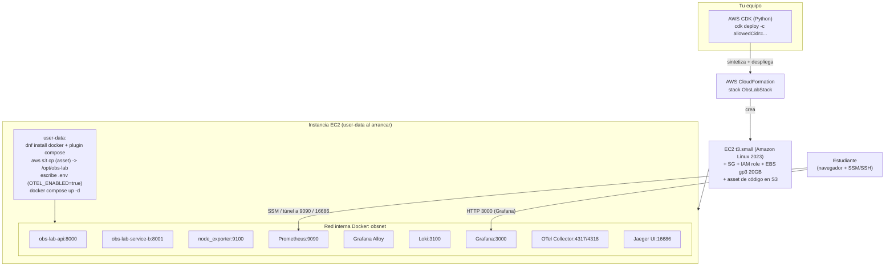

# Parte 1 — Métricas y Logs en AWS con CDK, EC2, Prometheus, Loki y Grafana

Tutorial práctico y reproducible. Aquí **despliegas toda la infraestructura con AWS CDK**:
una sola ejecución (`cdk deploy`) crea una instancia EC2 que, mediante *user-data*, instala
Docker y arranca automáticamente **todos** los servicios de observabilidad en contenedores.
No montas nada a mano ni en tu equipo local: el objetivo del laboratorio es que la infra se
aprovisione sola en AWS y que tú te concentres en **construir los dashboards** y, en la
Parte 2, **explorar las trazas**.

> Este es el primer tutorial del laboratorio. La Parte 2 (trazas distribuidas con
> OpenTelemetry y Jaeger) continúa en
> [`02-trazas-distribuidas-opentelemetry-jaeger.md`](./02-trazas-distribuidas-opentelemetry-jaeger.md)
> y reutiliza la **misma** instancia EC2 que despliegas aquí (sin volver a desplegar).

Cada paso indica: **qué se hace**, **por qué**, **el comando exacto**, **el directorio
desde el que ejecutarlo**, el **resultado esperado**, **cómo comprobar que funcionó** y
**qué revisar si falla**. Los bloques "Resultado esperado" describen lo que deberías
ver; **no** son salidas copiadas de una ejecución real.

---

## Índice

1. [Objetivos de aprendizaje](#1-objetivos-de-aprendizaje)
2. [Arquitectura: de CDK a los contenedores](#2-arquitectura-de-cdk-a-los-contenedores)
3. [Enfoque: todo con CDK, nada en local](#3-enfoque-todo-con-cdk-nada-en-local)
4. [Requisitos previos](#4-requisitos-previos)
5. [Configuración de AWS CLI y perfil `stay`](#5-configuración-de-aws-cli-y-perfil-stay)
6. [Bootstrap del entorno CDK (`cdk bootstrap`)](#6-bootstrap-del-entorno-cdk-cdk-bootstrap)
7. [Obtener tu IP y pasar `-c allowedCidr`](#7-obtener-tu-ip-y-pasar--c-allowedcidr)
8. [Desplegar la infraestructura (`cdk synth` y `cdk deploy`)](#8-desplegar-la-infraestructura-cdk-synth-y-cdk-deploy)
9. [Verificar que el user-data terminó y los contenedores están `Up`](#9-verificar-que-el-user-data-terminó-y-los-contenedores-están-up)
10. [Acceder a Grafana por la IP pública](#10-acceder-a-grafana-por-la-ip-pública)
11. [Construir el dashboard de CPU (node_exporter)](#11-construir-el-dashboard-de-cpu-node_exporter)
12. [Construir el dashboard de respuestas de la API](#12-construir-el-dashboard-de-respuestas-de-la-api)
13. [Generación de tráfico](#13-generación-de-tráfico)
14. [Verificación de métricas y logs](#14-verificación-de-métricas-y-logs)
15. [Troubleshooting](#15-troubleshooting)
16. [Seguridad: puertos, SSM y túneles](#16-seguridad-puertos-ssm-y-túneles)
17. [Estimación de costes](#17-estimación-de-costes)
18. [Limpieza con `cdk destroy`](#18-limpieza-con-cdk-destroy)

---

## 1. Objetivos de aprendizaje

Al terminar esta parte sabrás responder dos preguntas fundamentales de la observabilidad,
partiendo de una infraestructura que **tú mismo despliegas con una sola orden de CDK**:

- **¿Cómo conozco el estado de salud y el consumo de recursos de una instancia EC2?**
  Usarás las métricas que `node_exporter` expone del sistema operativo (CPU, memoria,
  disco, red) y construirás un **dashboard de CPU** en Grafana.
- **¿Cómo observo el comportamiento de una API?** Construirás un **dashboard de respuestas
  de la API** (latencia p50/p90/p99, solicitudes por endpoint, códigos HTTP 2xx/4xx/5xx,
  tasa de error y req/s) a partir de las métricas Prometheus de una API FastAPI, y
  consultarás sus logs estructurados en Loki.

Conceptos clave que practicarás:

- **Infraestructura como código con AWS CDK**: `cdk bootstrap`, `cdk synth`, `cdk deploy`
  y `cdk destroy`, y cómo el *user-data* de la EC2 arranca todo el stack con Docker Compose.
- Diferencia entre **métricas del SO vía `node_exporter`** y **métricas nativas de
  Amazon CloudWatch** (no son lo mismo; ver [sección 11](#11-construir-el-dashboard-de-cpu-node_exporter)).
- Uso de **etiquetas de baja cardinalidad** (plantilla de ruta normalizada, nunca la ruta
  concreta con valores dinámicos).
- **Percentiles de latencia** (p50/p90/p99) calculados con `histogram_quantile` sobre los
  buckets de un histograma.

---

## 2. Arquitectura: de CDK a los contenedores

La idea central: ejecutas **AWS CDK** desde tu equipo; CDK genera una plantilla de
**CloudFormation** que crea una instancia **EC2**; el *user-data* de esa instancia instala
Docker y lanza **Docker Compose**, que arranca **todos** los servicios en la red interna
`obsnet`. Tú no instalas nada a mano.



Flujo resumido:

1. **CDK → CloudFormation**: `cdk deploy` sube el código del laboratorio como un *asset*
   a S3 y crea el stack `ObsLabStack` (VPC lookup, Security Group, IAM role, EC2, EBS).
2. **user-data (al primer arranque)**: instala Docker y el plugin de Compose, descarga el
   asset a `/opt/obs-lab`, escribe un `.env` con `OTEL_ENABLED=true` y ejecuta
   `docker compose up -d`.
3. **Contenedores**: arrancan la API, `service-b`, `node_exporter`, Prometheus, Loki,
   Grafana Alloy, Grafana, el OTel Collector y Jaeger, todos en la red `obsnet`.
4. **Tú**: accedes a Grafana por la IP pública (`:3000`) y construyes los dashboards; a
   Prometheus (9090) y Jaeger (16686), que son internos, los alcanzas por SSM o túnel.

---

## 3. Enfoque: todo con CDK, nada en local

Este laboratorio está diseñado para que la infraestructura se **aprovisione en AWS con
CDK** y quede lista sin montaje manual. No ejecutas el stack en tu portátil ni instalas
Docker a mano en la instancia: el `cdk deploy` crea la EC2 y su *user-data* arranca todos
los servicios automáticamente. Así cualquier estudiante obtiene el **mismo** entorno
reproducible con una sola orden, y el tutorial se concentra en lo que importa: construir
los dos dashboards y explorar las trazas. Existe un camino local opcional con
`docker compose` (ver el apéndice del `README.md`), pero es solo para trabajar sin conexión
y **no** es la ruta principal del laboratorio.

---

## 4. Requisitos previos

**Qué se hace:** preparar tu equipo local antes de desplegar nada.

**Por qué:** evita errores de permisos o de versión en mitad del despliegue.

Necesitas en tu máquina local:

- **AWS CLI v2** instalada y configurada (perfil `stay`, ver [sección 5](#5-configuración-de-aws-cli-y-perfil-stay)).
- **Node.js** (lo usa el CLI de `cdk`, aunque la app CDK esté escrita en Python).
- **Python 3.12** y `pip` (para instalar las dependencias de la app CDK).
- El **AWS CDK CLI v2**: `npm i -g aws-cdk`.
- `curl` (para consultar tu IP pública).
- El repositorio de este laboratorio clonado localmente (contiene el directorio `cdk/`).

**Comando exacto** (directorio: cualquiera):

```bash
aws --version
node --version
python3 --version
cdk --version
curl --version | head -n1
```

**Resultado esperado:** `aws-cli/2.x.x`, una versión de Node 18+ (`v22.x` en el host de
referencia), `Python 3.12.x`, una versión de `aws-cdk` 2.x y una línea de versión de curl.

**Cómo comprobar:** los cinco comandos imprimen una versión sin error.

**Qué revisar si falla:**
- `cdk: command not found`: instala el CLI con `npm i -g aws-cdk` (requiere Node.js).
- `aws` no existe o es v1: instala/actualiza a AWS CLI v2.
- Python no es 3.12: usa `python3.12` explícitamente o un gestor de versiones.

---

## 5. Configuración de AWS CLI y perfil `stay`

**Qué se hace:** configurar un perfil de AWS CLI llamado `stay` apuntando a la cuenta del
laboratorio y verificar la identidad y la región.

**Por qué:** todas las operaciones de AWS de este laboratorio usan el perfil `stay`. No
debemos cambiar silenciosamente a otra cuenta o perfil.

Datos verificados de la cuenta de este laboratorio (úsalos tal cual):

| Dato | Valor |
|------|-------|
| Perfil AWS CLI | `stay` |
| Account ID | `550428926318` |
| Usuario IAM | `arn:aws:iam::550428926318:user/JuanHoyos` |
| Región | `us-east-1` |
| VPC por defecto | `vpc-059b7fcb3ae44690e` (CIDR `172.31.0.0/16`) |
| Key pair existente | `ec2-docker-api-key` |
| Prefijo de recursos | `obs-lab` |
| Etiqueta común | `Project=obs-lab` |

> **Recursos que NO debes tocar.** En esta cuenta existen funciones Lambda y recursos de
> otros proyectos (`soc-challenge-*`, `SocChallenge-*`, `lumen-production-*`). No los
> modifiques ni elimines. Todos los recursos de este laboratorio llevan el prefijo
> `obs-lab` y la etiqueta `Project=obs-lab` para distinguirlos.

**Comando exacto** (directorio: cualquiera). Si el perfil `stay` aún no existe, créalo:

```bash
aws configure --profile stay
# AWS Access Key ID [None]: <tu access key del usuario JuanHoyos>
# AWS Secret Access Key [None]: <tu secret key>
# Default region name [None]: us-east-1
# Default output format [None]: json
```

Luego verifica identidad y región:

```bash
aws sts get-caller-identity --profile stay
aws configure get region --profile stay
```

**Resultado esperado:** `get-caller-identity` devuelve un JSON con
`"Account": "550428926318"` y `"Arn": "arn:aws:iam::550428926318:user/JuanHoyos"`, y la
región configurada es `us-east-1`.

**Cómo comprobar:** el `Account` y el `Arn` coinciden con la tabla anterior.

**Qué revisar si falla:**
- `InvalidClientTokenId` o `SignatureDoesNotMatch`: las claves del perfil `stay` son
  incorrectas; reconfigúralas con `aws configure --profile stay`.
- Si `get-caller-identity` muestra otra cuenta, estás usando otro perfil; añade
  `--profile stay` a todos los comandos.

> **Seguridad:** nunca guardes las claves en el repositorio, en archivos `.env`
> versionados, en imágenes de contenedor ni en los logs. La AWS CLI las almacena en
> `~/.aws/credentials`, fuera del proyecto. Las aplicaciones dentro de EC2 **no** usan
> estas claves: usan el **IAM role** `obs-lab-ec2-role` que crea el CDK.

---

## 6. Bootstrap del entorno CDK (`cdk bootstrap`)

**Qué se hace:** preparar la cuenta/región para desplegar aplicaciones CDK.

**Por qué:** el CDK necesita, **una sola vez por cuenta y región**, un conjunto de recursos
de arranque (el "bootstrap stack" `CDKToolkit`): principalmente un **bucket de S3** donde
se suben los *assets* (como el código del laboratorio) y unos **roles IAM** que
CloudFormation usa para desplegar. Sin bootstrap, `cdk deploy` falla indicando que el
entorno no está preparado.

**Comando exacto** (directorio: cualquiera):

```bash
cdk bootstrap aws://550428926318/us-east-1 --profile stay
```

**Resultado esperado:** el CDK crea (o actualiza) el stack `CDKToolkit` y, al terminar,
informa de que el entorno `aws://550428926318/us-east-1` quedó *bootstrapped*. Si ya se
hizo antes, el comando es idempotente y no cambia nada relevante.

**Cómo comprobar:** no hay error y el mensaje final confirma el *bootstrap*. También puedes
ver el stack `CDKToolkit` en la consola de CloudFormation (región `us-east-1`).

**Qué revisar si falla:**
- `AccessDenied`: al usuario `JuanHoyos` le faltan permisos para crear el stack de
  bootstrap (S3/IAM/CloudFormation); revisa sus políticas en IAM.
- Región equivocada: confirma que usas `us-east-1` en el ARN del entorno y en el perfil.

---

## 7. Obtener tu IP y pasar `-c allowedCidr`

**Qué se hace:** averiguar tu IP pública actual para que el Security Group abra el acceso
**solo desde tu equipo**.

**Por qué:** abrir SSH (22) o Grafana (3000) a `0.0.0.0/0` expondría el laboratorio a
Internet. El stack **exige** que indiques tu CIDR con el parámetro de contexto
`allowedCidr`; si lo omites, el `cdk synth`/`cdk deploy` falla con un mensaje que te pide
pasarlo (principio de mínimo privilegio).

**Comando exacto** (directorio: cualquiera):

```bash
curl -s https://checkip.amazonaws.com
```

**Resultado esperado:** una única línea con tu IPv4 pública, por ejemplo `203.0.113.45`.

En los comandos de las secciones siguientes pasarás tu IP directamente como contexto. La
forma recomendada, que calcula el CIDR `/32` en el momento, es:

```bash
-c allowedCidr=$(curl -s https://checkip.amazonaws.com)/32
```

**Cómo comprobar:** `curl -s https://checkip.amazonaws.com` imprime tu IP; añadiéndole
`/32` obtienes el CIDR de un solo host.

**Qué revisar si falla:** si no hay salida, revisa tu conexión. Si tu IP cambia (redes
domésticas con IP dinámica), vuelve a ejecutar `curl -s https://checkip.amazonaws.com` y
redeplega con el nuevo valor de `allowedCidr`.

---

## 8. Desplegar la infraestructura (`cdk synth` y `cdk deploy`)

**Qué se hace:** instalar las dependencias de la app CDK, validar la plantilla sin crear
nada (`cdk synth`) y, por último, desplegar (`cdk deploy`). **Es el estudiante quien
ejecuta `cdk deploy`**; este tutorial no lo ejecuta por ti.

**Por qué:** `cdk synth` sintetiza la plantilla de CloudFormation localmente y detecta
errores antes de tocar AWS; `cdk deploy` crea de verdad los recursos y arranca la EC2.

**Comando exacto** (directorio: `cdk/`, dentro del repositorio). Primero prepara un entorno
virtual de Python e instala las dependencias de la app CDK:

```bash
cd cdk
python3 -m venv .venv
. .venv/bin/activate
pip install -r requirements.txt
```

Valida la plantilla sin crear recursos:

```bash
cdk synth -c allowedCidr=$(curl -s https://checkip.amazonaws.com)/32 --profile stay
```

Despliega la infraestructura (lo ejecuta **el estudiante**):

```bash
cdk deploy -c allowedCidr=$(curl -s https://checkip.amazonaws.com)/32 --profile stay
```

Opciones de contexto adicionales (opcionales):

- `-c keyName=""` → no asociar key pair (acceso **solo por SSM**, sin SSH).
- `-c openApiPort=false` → no exponer el puerto 8000 de la API al exterior.

**Qué recursos crea el stack `ObsLabStack`:**

| Recurso | Detalle |
|---------|---------|
| VPC (lookup) | La VPC por defecto `vpc-059b7fcb3ae44690e`, subred pública |
| Security Group | `obs-lab-sg`: entrada **solo desde tu `allowedCidr`** a 22, 3000 y 8000 (opcional) |
| IAM role | `obs-lab-ec2-role` con `AmazonSSMManagedInstanceCore` + lectura del asset en S3 |
| EC2 | `t3.small`, Amazon Linux 2023, IP pública, etiqueta `Name=obs-lab-ec2` |
| EBS | Volumen raíz **gp3 de 20 GiB** en `/dev/xvda` |
| Asset S3 | El código del laboratorio empaquetado y subido al bucket de bootstrap |

**CfnOutputs** que imprime `cdk deploy` al terminar (los usarás en las siguientes
secciones):

| Output | Qué contiene |
|--------|--------------|
| `PublicIp` | La IP pública de la EC2 |
| `PublicDnsName` | El DNS público de la EC2 |
| `GrafanaUrl` | `http://<PublicIp>:3000` |
| `SsmSessionCommand` | `aws ssm start-session --target <instance-id> --profile stay` |
| `JaegerTunnelCommand` | El comando SSM/SSH para el túnel a Jaeger (16686), usado en la Parte 2 |

**Resultado esperado:** `cdk synth` imprime la plantilla de CloudFormation sin error.
`cdk deploy` muestra el progreso de creación del stack y, al finalizar, imprime los
`Outputs` de la tabla anterior (incluido `PublicIp` y `GrafanaUrl`).

**Cómo comprobar:** al terminar `cdk deploy`, anota el valor de `PublicIp` (lo usarás como
`<ip>` en adelante) y comprueba que `GrafanaUrl` es `http://<PublicIp>:3000`.

**Qué revisar si falla:**
- Error pidiendo `allowedCidr`: olvidaste `-c allowedCidr=...`; vuelve a pasarlo con tu IP.
- `This stack uses assets, so the toolkit stack must be deployed`: falta el `cdk bootstrap`
  de la [sección 6](#6-bootstrap-del-entorno-cdk-cdk-bootstrap).
- `from_lookup` pide credenciales: ejecuta con `--profile stay` (la resolución de la VPC
  ocurre durante tu `cdk deploy`).
- `AccessDenied` al desplegar: faltan permisos de EC2/IAM/CloudFormation al usuario.

---

## 9. Verificar que el user-data terminó y los contenedores están `Up`

**Qué se hace:** confirmar que el *user-data* instaló Docker y que los contenedores
arrancaron. El arranque completo tarda unos minutos tras el `cdk deploy` (descarga de
imágenes y build incluidos).

**Por qué:** `cdk deploy` termina cuando la EC2 existe, pero el *user-data* sigue
ejecutándose **después** en segundo plano. Hay que esperar a que acabe antes de usar
Grafana.

**Comando exacto — abrir una sesión en la instancia.** Opción recomendada, **SSM Session
Manager** (no requiere SSH ni abrir el puerto 22):

```bash
aws ssm start-session --target <instance-id> --profile stay
```

(usa el `SsmSessionCommand` que imprimió `cdk deploy`). Alternativa por **SSH** (requiere
el `.pem` del key pair y el 22 abierto a tu IP):

```bash
ssh -i ec2-docker-api-key.pem ec2-user@<ip>
```

Ya **dentro de la instancia**, revisa el progreso del *user-data* y el estado de los
contenedores:

```bash
# Log del user-data / cloud-init (muestra la instalación y el arranque de compose).
sudo tail -n 50 /var/log/cloud-init-output.log

# Estado de los contenedores del laboratorio.
cd /opt/obs-lab && sudo docker compose ps
# o, de forma genérica:
sudo docker ps
```

**Resultado esperado:** el final de `/var/log/cloud-init-output.log` muestra que el
*user-data* terminó sin error (líneas de `docker compose up -d`). `docker ps` lista los
**9 servicios** del laboratorio en estado `Up`: `obs-lab-api`, `obs-lab-service-b`,
`obs-lab-node-exporter`, `obs-lab-prometheus`, `obs-lab-loki`, `obs-lab-alloy`,
`obs-lab-grafana`, `obs-lab-otel-collector` y `obs-lab-jaeger`.

**Cómo comprobar:** los 9 contenedores aparecen `Up`; si acabas de desplegar y faltan,
espera uno o dos minutos y vuelve a ejecutar `docker ps` (el *user-data* aún puede estar
construyendo imágenes).

**Qué revisar si falla:**
- `docker ps` vacío o pocos servicios: el *user-data* sigue en curso o falló; revisa
  `/var/log/cloud-init-output.log` buscando el primer error.
- `permission denied` al socket de Docker: usa `sudo docker ...` (el usuario `ec2-user`
  entra en el grupo `docker` tras reiniciar la sesión).
- Un servicio en `Restarting`: `cd /opt/obs-lab && sudo docker compose logs <servicio>`.

---

## 10. Acceder a Grafana por la IP pública

**Qué se hace:** entrar a Grafana y confirmar que las fuentes de datos y la carpeta de
dashboards se aprovisionaron solas.

**Por qué:** Grafana es la interfaz donde construirás e interpretarás los dashboards.

Grafana (imagen `grafana/grafana:11.2.0`) publica el puerto `3000` y toma la contraseña de
admin de la variable `GF_SECURITY_ADMIN_PASSWORD`. **Importante:** en EC2 ese `.env` lo
**genera el user-data** con un valor por defecto (`changeme`); cámbialo si vas a dejar la
instancia encendida. El aprovisionamiento (`config/grafana/provisioning/`) crea tres
fuentes de datos con UIDs estables:

- **Prometheus** (uid `prometheus`, por defecto) → `http://prometheus:9090`.
- **Loki** (uid `loki`) → `http://loki:3100`, con un *derived field* que extrae `trace_id`
  del log JSON y lo enlaza a Jaeger (se usa en la Parte 2).
- **Jaeger** (uid `jaeger`) → `http://jaeger:16686` (operativa desde ya, porque el stack
  completo arranca de una vez).

**Comando exacto / acceso:** con el Security Group permitiendo el 3000 desde tu IP, abre en
tu navegador la URL que imprimió `cdk deploy` como `GrafanaUrl`:

```
http://<ip>:3000
```

Usuario `admin`, contraseña la del `.env` generado por el user-data (`changeme` por
defecto).

**Resultado esperado:** inicias sesión; en **Connections → Data sources** ves Prometheus,
Loki y Jaeger, con su "health check" en verde.

**Cómo comprobar:** navega a **Connections → Data sources** y confirma las tres fuentes.

**Qué revisar si falla:**
- No carga la página: confirma que el 3000 está abierto a tu IP (si tu IP cambió,
  redeplega con el nuevo `allowedCidr`, [sección 7](#7-obtener-tu-ip-y-pasar--c-allowedcidr)).
- Fuentes de datos ausentes: el stack aún arranca; revisa el estado con
  `sudo docker compose logs grafana` dentro de la EC2.

---

## 11. Construir el dashboard de CPU (node_exporter)

**Qué se hace:** crear paso a paso, en Grafana, un dashboard que visualice el **uso de CPU**
de la instancia a partir de las métricas de `node_exporter`.

**Por qué:** responde a "¿cuánta CPU consume la EC2?". Es la métrica de infraestructura más
básica para dimensionar y detectar saturación.

> **Importante — `node_exporter` NO es Amazon CloudWatch.**
> `node_exporter` (imagen `prom/node-exporter:v1.8.2`) lee el sistema operativo **desde
> dentro** de la instancia (monta `/:/host:ro` y usa `--path.rootfs=/host`) y expone
> métricas en el formato de Prometheus. **Amazon CloudWatch** es un servicio gestionado de
> AWS: su métrica `CPUUtilization` de EC2 se mide a nivel del hipervisor y se ve en la
> consola de AWS; para memoria o disco en CloudWatch haría falta el *CloudWatch agent*. En
> este laboratorio **todas** las métricas de infraestructura provienen de `node_exporter`
> (del SO), **no** de CloudWatch. No las presentes como si fueran de CloudWatch: son
> fuentes distintas.

**Pasos en la UI de Grafana:**

1. Menú **Dashboards → New → New dashboard → Add visualization**.
2. Elige la fuente de datos **Prometheus**.
3. En el editor del panel, pega esta consulta PromQL para el **porcentaje de uso de CPU**
   (100 menos el tiempo ocioso):

   ```promql
   100 - (avg by(instance) (rate(node_cpu_seconds_total{mode="idle"}[5m])) * 100)
   ```

4. Configura el panel:
   - **Visualization:** `Time series`.
   - **Unit:** `Percent (0-100)`.
   - **Min:** 0, **Max:** 100.
   - **Legend:** `{{instance}}` (o "CPU %").
   - **Title:** "Uso de CPU (%)".
5. Pulsa **Apply** para añadir el panel.
6. Arriba a la derecha, fija el **refresh** a `10s` y el rango de tiempo a "Últimos 15
   minutos".
7. **Save dashboard**: ponle de título "CPU de la instancia" y guárdalo.

> El laboratorio ya trae un dashboard de infraestructura provisionado
> (`config/grafana/dashboards/infra.json`) que incluye CPU/memoria/disco/red. Este ejercicio
> te enseña a construir el panel de CPU **a mano** para que entiendas la consulta; puedes
> compararlo con el provisionado.

**Resultado esperado:** una gráfica temporal con el porcentaje de CPU usado por la
instancia. En reposo rondará un valor bajo; subirá al generar tráfico
([sección 13](#13-generación-de-tráfico)).

**Cómo comprobar:** el panel dibuja una línea con valores entre 0 y 100; al lanzar el
generador de tráfico, la línea sube de forma visible.

**Qué revisar si falla:**
- Panel vacío ("No data"): confirma en Prometheus que el target `node_exporter` está `UP`
  (ver [sección 14](#14-verificación-de-métricas-y-logs)) y que el rango de tiempo incluye
  "ahora".
- Error de PromQL: revisa que copiaste la expresión completa, incluido `by(instance)`.

---

## 12. Construir el dashboard de respuestas de la API

**Qué se hace:** crear paso a paso un segundo dashboard para **monitorear las respuestas de
la API**: latencia (p50/p90/p99), número de solicitudes (total y por endpoint), códigos
HTTP (2xx/4xx/5xx), tasa de error y req/s.

**Por qué:** responde a "¿cómo se comporta la API?". Son las métricas que un SRE mira para
detectar lentitud o fallos.

Contexto de las métricas (instrumentación en `app/metrics.py`, con **plantilla de ruta
normalizada** para evitar alta cardinalidad):

- `api_requests_total{method,route,status}` — contador de solicitudes.
- `api_requests_by_status_class_total{method,route,status_class}` — contador por clase
  `2xx`/`4xx`/`5xx`.
- `api_request_duration_seconds` — **histograma** de latencia (buckets `0.005 … 10.0 s`).
- `api_up` — *gauge* de liveness (1 = arriba).

**Pasos en la UI de Grafana.** Crea un dashboard nuevo (**Dashboards → New → New
dashboard**) y añade un panel por cada consulta siguiente (puedes reutilizar el PromQL del
dashboard provisionado `config/grafana/dashboards/api.json`):

1. **Solicitudes por segundo (req/s)** — panel `Stat` o `Time series`, unidad `reqps`:

   ```promql
   sum(rate(api_requests_total[5m]))
   ```

2. **Solicitudes por endpoint** — panel `Time series`, unidad `reqps`, leyenda `{{route}}`:

   ```promql
   sum by (route) (rate(api_requests_total[5m]))
   ```

3. **Latencia p50 / p90 / p99** — panel `Time series`, unidad `s`. Añade tres *queries* al
   mismo panel (una por percentil), cambiando el primer argumento `0.50`, `0.90`, `0.99`:

   ```promql
   histogram_quantile(0.90, sum by (le, route) (rate(api_request_duration_seconds_bucket[5m])))
   ```

   Para un panel agregado (sin desglose por ruta) usa `sum by (le)` en lugar de
   `sum by (le, route)`.

4. **Respuestas 2xx / 4xx / 5xx (req/s)** — panel `Time series`, unidad `reqps`, leyenda
   `{{status_class}}`:

   ```promql
   sum by (status_class) (rate(api_requests_by_status_class_total[5m]))
   ```

5. **Solicitudes por código HTTP** — panel `Time series`, unidad `reqps`, leyenda
   `{{status}}`:

   ```promql
   sum by (status) (rate(api_requests_total[5m]))
   ```

6. **Tasa de error (5xx %)** — panel `Stat`, unidad `percent`:

   ```promql
   100 * sum(rate(api_requests_by_status_class_total{status_class="5xx"}[5m]))
     / clamp_min(sum(rate(api_requests_by_status_class_total[5m])), 1)
   ```

7. Fija el **refresh** a `10s` y el rango a "Últimos 15 minutos". **Save dashboard** con el
   título "Respuestas de la API".

**Resultado esperado:** un dashboard con paneles de req/s, solicitudes por endpoint,
percentiles de latencia, clases de estado 2xx/4xx/5xx, códigos HTTP y tasa de error. En
reposo estarán planos; cobran vida al generar tráfico.

**Cómo comprobar:** tras lanzar el generador ([sección 13](#13-generación-de-tráfico)), los
paneles muestran subir las solicitudes/seg, aparecer barras 4xx/5xx y moverse los
percentiles de latencia (la variante lenta eleva p90/p99).

**Qué revisar si falla:**
- Paneles vacíos: aún no hay tráfico, o el target `api` de Prometheus está `DOWN` (ver
  [sección 14](#14-verificación-de-métricas-y-logs)).
- Percentiles planos a 0: confirma que usas los `_bucket` del histograma y que hay
  peticiones recientes dentro de la ventana `[5m]`.

---

## 13. Generación de tráfico

**Qué se hace:** generar tráfico mixto (éxitos, 404, 500, 400 y peticiones lentas) para ver
reaccionar los dashboards.

**Por qué:** sin tráfico los paneles de la API están vacíos. El generador produce una
mezcla ponderada hacia el éxito con un goteo constante de errores y lentitud.

El script es `scripts/load_test.py` (usa `httpx`, con un ritmo seguro para `t3.small`).
Acepta `--duration`, `--rate` y `--base-url`. Puedes lanzarlo **desde tu equipo local**
apuntando a la IP pública de la EC2 (si abriste el puerto 8000), o **dentro de la EC2**
contra `localhost`.

**Comando exacto — desde tu equipo local** (directorio: la raíz del repo), apuntando a la
IP pública:

```bash
python3 -m venv .venv && . .venv/bin/activate
pip install httpx
python scripts/load_test.py --duration 120 --rate 3 --base-url http://<ip>:8000
```

(sustituye `<ip>` por el valor de `PublicIp` del `cdk deploy`). Si no abriste el 8000,
ejecútalo dentro de la EC2 con `--base-url http://localhost:8000`.

**Resultado esperado:** el script imprime que genera tráfico durante 120 s a ~3 req/s y, al
final, un resumen con el conteo por código HTTP (200, 400, 404 y 500).

**Cómo comprobar:** mientras corre, el dashboard de la API muestra subir las
solicitudes/seg, aparecer barras 4xx/5xx y cambiar los percentiles de latencia; el
dashboard de CPU muestra un repunte de uso.

**Qué revisar si falla:**
- `connection refused` desde local: no abriste el puerto 8000 en el Security Group
  (redeplega sin `-c openApiPort=false`) o la IP es incorrecta. Alternativa: ejecútalo
  dentro de la EC2 con `http://localhost:8000`.
- Ritmo demasiado alto para una `t3.small`: baja `--rate` (3 req/s es seguro).

---

## 14. Verificación de métricas y logs

**Qué se hace:** confirmar de punta a punta que métricas y logs se observan.

**Por qué:** es la comprobación de aceptación de la Parte 1.

**Pasos:**

1. **Targets de Prometheus** (interno; por SSM/túnel, ver
   [sección 16](#16-seguridad-puertos-ssm-y-túneles)): abre `http://localhost:9090/targets`.
   **Resultado esperado:** `api`, `service-b`, `node_exporter` y `prometheus` en `UP`.

2. **Métricas de la API** (dentro de la EC2):
   ```bash
   curl -s http://localhost:8000/metrics | grep api_requests_total | head
   ```
   **Resultado esperado:** series con `route="/products/{product_id}"` y distintos
   `status`.

3. **Dashboards** (navegador, Grafana): con tráfico corriendo, el dashboard de respuestas
   de la API muestra actividad y el de CPU muestra el consumo de la instancia.

4. **Logs en Loki** (Grafana → Explore → Loki): consulta
   ```
   {service="obs-lab-api"} | json
   ```
   y, para ver errores:
   ```
   {service="obs-lab-api"} | json | status >= 500
   ```
   **Resultado esperado:** líneas JSON de peticiones; las de error 500 (de
   `/simulate-error?mode=server`) traen su `correlation_id`.

5. **Correlación métrica → log:** observa un pico de 5xx en el dashboard de la API, anota la
   ventana de tiempo y filtra `status >= 500` en Loki en esa ventana.

**Cómo comprobar:** cada paso devuelve lo descrito en su "Resultado esperado".

**Qué revisar si falla:** vuelve a la sección del componente afectado y, dentro de la EC2,
revisa `cd /opt/obs-lab && sudo docker compose logs <servicio>`.

---

## 15. Troubleshooting

| Síntoma | Causa probable | Qué revisar / cómo arreglar |
|---------|----------------|-----------------------------|
| `cdk deploy` pide `allowedCidr` | Falta `-c allowedCidr=...` | Pásalo con `-c allowedCidr=$(curl -s https://checkip.amazonaws.com)/32` |
| `must be bootstrapped` | No corriste `cdk bootstrap` | Ejecuta `cdk bootstrap aws://550428926318/us-east-1 --profile stay` |
| `from_lookup` pide credenciales | No pasaste `--profile stay` | Añade `--profile stay`; la VPC se resuelve en tu `cdk deploy` |
| Los contenedores no están `Up` | El user-data aún corre o falló | Dentro de la EC2: `sudo tail -n 80 /var/log/cloud-init-output.log` |
| No puedo abrir Grafana (3000) | SG no permite tu IP o tu IP cambió | Reconsulta `curl -s https://checkip.amazonaws.com` y redeplega con el nuevo `allowedCidr` |
| `connection refused` al 8000 | Puerto 8000 no abierto | Redeplega sin `-c openApiPort=false`, o usa `localhost:8000` dentro de la EC2 |
| Target `api`/`node_exporter` DOWN | Contenedor caído | Dentro de la EC2: `sudo docker compose ps` y `logs <servicio>` |
| No hay logs en Loki | Alloy no descubre el contenedor | `sudo docker compose logs alloy` dentro de la EC2 |
| OOM / instancia lenta | Instancia demasiado pequeña | El stack usa `t3.small` (2 GiB); no bajes de ahí |

---

## 16. Seguridad: puertos, SSM y túneles

**Qué se hace:** entender qué puertos abre el Security Group, a quién, y cómo acceder de
forma segura a los servicios internos.

**Por qué:** minimizar la exposición a Internet (mínimo privilegio) y no filtrar
credenciales.

Política de puertos del Security Group `obs-lab-sg` (creado por el CDK):

| Puerto | Servicio | Exposición | Quién accede |
|--------|----------|------------|--------------|
| 22 | SSH | Abierto **solo a tu `allowedCidr`** | El estudiante (opcional; SSM lo hace innecesario) |
| 3000 | Grafana | Abierto **solo a tu `allowedCidr`** | El estudiante, desde el navegador |
| 8000 | API | **Opcional** (`-c openApiPort`), solo a tu `allowedCidr` | El estudiante, para llamar a la API |
| 9090 | Prometheus | **Interno** (no en el SG) | Vía SSM port-forward o túnel SSH |
| 3100 | Loki | **Interno** | Normalmente desde Grafana |
| 4317/4318 | OTel Collector | **Interno** | Solo tráfico interno `obsnet` |
| 16686 | Jaeger UI | **Interno** | Vía SSM port-forward o túnel SSH (Parte 2) |

**SSM frente a SSH:** la EC2 lleva el rol `obs-lab-ec2-role` con
`AmazonSSMManagedInstanceCore`, así que puedes administrarla y abrir *port-forwards* con
**SSM Session Manager sin abrir el puerto 22**. Si prefieres no exponer SSH, despliega con
`-c keyName=""` (acceso solo por SSM).

**Comando exacto — reenvío de puertos a Prometheus por SSM** (desde tu equipo local):

```bash
aws ssm start-session --target <instance-id> \
  --document-name AWS-StartPortForwardingSession \
  --parameters '{"portNumber":["9090"],"localPortNumber":["9090"]}' \
  --profile stay
```

Alternativa por **túnel SSH** (si usas key pair):

```bash
ssh -i ec2-docker-api-key.pem -L 9090:localhost:9090 ec2-user@<ip>
```

Con cualquiera de los dos, `http://localhost:9090/targets` en tu navegador local llega a
Prometheus sin exponerlo a Internet.

**Resultado esperado:** la página de Prometheus carga por el reenvío; al cerrarlo, se
vuelve inaccesible (prueba de que no está expuesta públicamente).

**Cómo comprobar:** `http://localhost:9090/targets` responde mientras el *port-forward*
está activo.

**Qué revisar si falla:** si el SSM *port-forward* no conecta, confirma que el agente SSM
está activo (requiere que el user-data haya terminado) y que el rol tiene
`AmazonSSMManagedInstanceCore`. Nunca abras 9090/3100/16686 en el Security Group.

> **Recordatorio de seguridad:** no incrustes credenciales en el repo, en `.env`
> versionados, en imágenes ni en logs. Dentro de EC2 se usa el IAM role `obs-lab-ec2-role`;
> la contraseña de Grafana vive solo en el `.env` que genera el user-data en la instancia.

---

## 17. Estimación de costes

**Qué se hace:** estimar el coste del laboratorio antes y durante el uso.

**Por qué:** el laboratorio debe ser económico y no generar gastos sorpresa.

Órdenes de magnitud en `us-east-1` (precios bajo demanda, orientativos; consulta la
calculadora de precios de AWS para cifras exactas de tu cuenta):

| Recurso | Dimensión | Coste aproximado |
|---------|-----------|------------------|
| EC2 `t3.small` | ~2 vCPU, 2 GiB, bajo demanda | ~0.0208 USD/hora (~0.50 USD/día si está encendida 24 h) |
| EBS gp3 | 20 GiB | ~0.08 USD/GB-mes → ~1.6 USD/mes |
| IP pública (IPv4) | 1 dirección | AWS cobra las IPv4 públicas por hora (orden de ~0.005 USD/hora) |
| S3 (asset del CDK) | ~pocos cientos de KB | Despreciable |
| Transferencia de datos | Tráfico del laboratorio (bajo) | Normalmente despreciable para este uso |

Notas importantes:

- **No** se usan NAT Gateway ni Application Load Balancer (serían costes recurrentes
  elevados e innecesarios para un laboratorio en una sola instancia).
- **`cdk destroy` elimina TODO** lo que creó el stack (EC2, EBS, Security Group, IAM role),
  así que es la forma limpia de dejar de pagar (ver [sección 18](#18-limpieza-con-cdk-destroy)).
- **Apagar (`stop`) la instancia NO elimina los costes de EBS ni de la IP pública:** el
  volumen gp3 se sigue cobrando mientras exista y una IPv4 pública asignada también genera
  cargo por hora. Para dejar de pagar por completo, usa `cdk destroy`.

**Resultado esperado:** un coste diario de céntimos a muy pocos dólares si destruyes el
stack al terminar.

**Cómo comprobar:** revisa **Billing → Cost Explorer** en la consola de AWS filtrando por
la etiqueta `Project=obs-lab`.

**Qué revisar si falla (coste inesperado):** confirma que `cdk destroy` terminó sin dejar
recursos; busca volúmenes EBS o IPs huérfanos con la etiqueta del proyecto.

---

## 18. Limpieza con `cdk destroy`

**Qué se hace:** eliminar **toda** la infraestructura del laboratorio con una sola orden.

**Por qué:** para dejar de incurrir en costes y mantener la cuenta limpia, sin borrar nada
a mano. Recuerda: no toques `soc-challenge-*`, `SocChallenge-*` ni `lumen-production-*`.

**Comando exacto** (directorio: `cdk/`, con el entorno virtual activo):

```bash
cd cdk
. .venv/bin/activate
cdk destroy -c allowedCidr=$(curl -s https://checkip.amazonaws.com)/32 --profile stay
```

Confirma con `y` cuando el CDK pregunte. El `-c allowedCidr=...` sigue siendo necesario
porque la app lo exige para sintetizar el stack.

**Resultado esperado:** el CDK elimina el stack `ObsLabStack`; al terminar informa de que
el stack fue destruido. La instancia EC2, el volumen EBS, el Security Group y el IAM role
dejan de existir.

**Cómo comprobar:**

```bash
aws cloudformation describe-stacks --stack-name ObsLabStack --profile stay --region us-east-1
```

Debe devolver un error indicando que el stack **ya no existe** (`Stack with id ObsLabStack
does not exist`).

**Qué revisar si falla:**
- `cdk destroy` pide `allowedCidr`: vuelve a pasarlo como en el comando anterior.
- El stack queda en `DELETE_FAILED`: revisa en la consola de CloudFormation qué recurso
  bloquea el borrado (por ejemplo, una dependencia manual) y reintenta.
- No borres recursos que no lleven la etiqueta `Project=obs-lab`.

---

Con esto completas la **Parte 1**: desplegaste toda la infraestructura con AWS CDK,
construiste el dashboard de CPU y el de respuestas de la API, y verificaste métricas y
logs. Continúa con la Parte 2 para explorar las trazas distribuidas sobre la **misma**
infraestructura:
[`02-trazas-distribuidas-opentelemetry-jaeger.md`](./02-trazas-distribuidas-opentelemetry-jaeger.md).
