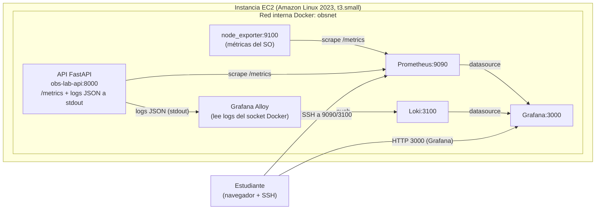

# Parte 1 — Métricas y Logs en AWS con EC2, Prometheus, Loki y Grafana

Tutorial práctico y reproducible para desplegar, desde cero y en tu propia cuenta de
AWS, un laboratorio de observabilidad que recolecta **métricas** (de la instancia EC2
y de una API FastAPI) y **logs** (de la API) y los visualiza en Grafana.

> Este es el primer tutorial del laboratorio. La Parte 2 (trazas distribuidas con
> OpenTelemetry y Jaeger) continúa en
> [`02-trazas-distribuidas-opentelemetry-jaeger.md`](./02-trazas-distribuidas-opentelemetry-jaeger.md)
> y reutiliza la misma instancia EC2 que creas aquí.

Cada paso indica: **qué se hace**, **por qué**, **el comando exacto**, **el directorio
desde el que ejecutarlo**, el **resultado esperado**, **cómo comprobar que funcionó** y
**qué revisar si falla**. Los bloques "Resultado esperado" describen lo que deberías
ver; no son salidas copiadas de una ejecución real.

---

## Índice

1. [Objetivos de aprendizaje](#1-objetivos-de-aprendizaje)
2. [Arquitectura y flujo de métricas y logs](#2-arquitectura-y-flujo-de-métricas-y-logs)
3. [Requisitos previos](#3-requisitos-previos)
4. [Configuración de AWS CLI y perfil `stay`](#4-configuración-de-aws-cli-y-perfil-stay)
5. [Creación y configuración de la instancia EC2](#5-creación-y-configuración-de-la-instancia-ec2)
6. [Instalación de Docker y Docker Compose](#6-instalación-de-docker-y-docker-compose)
7. [La API FastAPI de demostración](#7-la-api-fastapi-de-demostración)
8. [Instrumentación de métricas (Prometheus)](#8-instrumentación-de-métricas-prometheus)
9. [node_exporter: métricas del sistema operativo](#9-node_exporter-métricas-del-sistema-operativo)
10. [Prometheus](#10-prometheus)
11. [Loki + Grafana Alloy: recolección de logs](#11-loki--grafana-alloy-recolección-de-logs)
12. [Grafana](#12-grafana)
13. [Los dos dashboards](#13-los-dos-dashboards)
14. [Generación de tráfico](#14-generación-de-tráfico)
15. [Verificación de métricas, logs y errores](#15-verificación-de-métricas-logs-y-errores)
16. [Troubleshooting](#16-troubleshooting)
17. [Seguridad: puertos y túneles SSH](#17-seguridad-puertos-y-túneles-ssh)
18. [Estimación de costes](#18-estimación-de-costes)
19. [Limpieza y eliminación segura de recursos](#19-limpieza-y-eliminación-segura-de-recursos)

---

## 1. Objetivos de aprendizaje

Al terminar esta parte sabrás responder dos preguntas fundamentales de la observabilidad:

- **¿Cómo conozco el estado de salud y el consumo de recursos de una instancia EC2?**
  Instalarás `node_exporter` para exponer métricas del sistema operativo (CPU, memoria,
  disco, red) y las verás en un dashboard de Grafana.
- **¿Cómo observo el comportamiento de una API?** Instrumentarás una API FastAPI con
  métricas compatibles con Prometheus (tasa de solicitudes, errores y latencias) y
  recolectarás sus logs estructurados en Loki para consultarlos desde Grafana.

Conceptos clave que practicarás:

- Diferencia entre **métricas del SO vía `node_exporter`** y **métricas nativas de
  Amazon CloudWatch** (no son lo mismo; ver [sección 9](#9-node_exporter-métricas-del-sistema-operativo)).
- Uso de **etiquetas de baja cardinalidad** (plantilla de ruta normalizada, nunca la
  ruta concreta con valores dinámicos).
- **Percentiles de latencia** (p50/p90/p99) calculados con `histogram_quantile` sobre
  los buckets de un histograma.
- **Correlación** entre lo que ves en un dashboard y las líneas de log en Loki mediante
  un identificador de correlación.

---

## 2. Arquitectura y flujo de métricas y logs

Todos los componentes corren como contenedores en una sola instancia EC2, sobre una red
interna de Docker llamada `obsnet`. Solo dos puertos se publican al host: la API (8000)
y Grafana (3000). El resto son internos y se consultan por túnel SSH.



Flujo resumido:

1. **Métricas del SO**: `node_exporter` lee el sistema de archivos del host montado en
   `/host` y expone métricas en `:9100`. Prometheus las recolecta ("scrapea").
2. **Métricas de la API**: la API expone `/metrics` en formato Prometheus; Prometheus la
   recolecta cada 15 s.
3. **Logs de la API**: la API escribe logs JSON por *stdout*; el contenedor de Docker los
   captura; Grafana Alloy los descubre vía el socket de Docker y los envía a Loki.
4. **Visualización**: Grafana usa Prometheus y Loki como fuentes de datos y muestra dos
   dashboards (infraestructura y API).

---

## 3. Requisitos previos

**Qué se hace:** preparar tu equipo local y tu cuenta de AWS antes de desplegar nada.

**Por qué:** evita errores de permisos o de versión en mitad del despliegue.

Necesitas en tu máquina local:

- **AWS CLI v2** instalada.
- Un cliente **SSH** (incluido en Linux/macOS; en Windows usa WSL o PowerShell).
- `curl` (para consultar tu IP pública).
- Acceso a una cuenta de AWS con permisos para EC2, IAM y VPC.
- El repositorio de este laboratorio clonado localmente (lo copiarás a la EC2 más adelante).

**Comando exacto** (directorio: cualquiera):

```bash
aws --version
ssh -V
curl --version | head -n1
```

**Resultado esperado:** `aws-cli/2.x.x`, una versión de OpenSSH y una línea de versión de
curl. Si `aws` no existe, instala la AWS CLI v2 siguiendo la documentación oficial de AWS.

**Cómo comprobar:** los tres comandos imprimen una versión sin error.

**Qué revisar si falla:** si `aws` no se encuentra, revisa tu `PATH` y la instalación. Si
tu AWS CLI es v1, actualízala a v2 (los comandos de este tutorial asumen v2).

---

## 4. Configuración de AWS CLI y perfil `stay`

**Qué se hace:** configurar un perfil de AWS CLI llamado `stay` apuntando a la cuenta del
laboratorio y verificar la identidad y la región.

**Por qué:** todas las operaciones de AWS de este laboratorio usan el perfil `stay`. No
debemos cambiar silenciosamente a otra cuenta o perfil.

Datos verificados de la cuenta de este laboratorio (úsalos tal cual):

| Dato | Valor |
|------|-------|
| Perfil AWS CLI | `stay` |
| Account ID | `550428926318` |
| Usuario IAM | `arn:aws:iam::550428926318:user/JuanHoyos` |
| Región | `us-east-1` |
| VPC por defecto | `vpc-059b7fcb3ae44690e` (CIDR `172.31.0.0/16`) |
| Key pair existente | `ec2-docker-api-key` |
| Prefijo de recursos | `obs-lab` |
| Etiqueta común | `Project=obs-lab` |

> **Recursos que NO debes tocar.** En esta cuenta existen funciones Lambda y recursos de
> otros proyectos (`soc-challenge-*`, `SocChallenge-*`, `lumen-production-*`). No los
> modifiques ni elimines. Todos los recursos de este laboratorio llevan el prefijo
> `obs-lab` y la etiqueta `Project=obs-lab` para distinguirlos.

**Comando exacto** (directorio: cualquiera). Si el perfil `stay` aún no existe, créalo:

```bash
aws configure --profile stay
# AWS Access Key ID [None]: <tu access key del usuario JuanHoyos>
# AWS Secret Access Key [None]: <tu secret key>
# Default region name [None]: us-east-1
# Default output format [None]: json
```

Luego verifica identidad y región:

```bash
aws sts get-caller-identity --profile stay
aws configure get region --profile stay
```

**Resultado esperado:** `get-caller-identity` devuelve un JSON con
`"Account": "550428926318"` y `"Arn": "arn:aws:iam::550428926318:user/JuanHoyos"`, y la
región configurada es `us-east-1`.

**Cómo comprobar:** el `Account` y el `Arn` coinciden con la tabla anterior.

**Qué revisar si falla:**
- `InvalidClientTokenId` o `SignatureDoesNotMatch`: las claves del perfil `stay` son
  incorrectas; reconfigúralas con `aws configure --profile stay`.
- Si `get-caller-identity` muestra otra cuenta, estás usando otro perfil; añade
  `--profile stay` a todos los comandos o exporta `export AWS_PROFILE=stay`.

> **Seguridad:** nunca guardes las claves en el repositorio, en archivos `.env`
> versionados, en imágenes de contenedor ni en los logs. La AWS CLI las almacena en
> `~/.aws/credentials`, fuera del proyecto. Las aplicaciones dentro de EC2 **no** usarán
> estas claves: usarán un **IAM role** adjunto a la instancia (ver [sección 5](#54-rol-iam-de-la-instancia-obs-lab-ec2-role)).

---

## 5. Creación y configuración de la instancia EC2

Todos los comandos de esta sección se ejecutan **en tu máquina local** (directorio:
cualquiera) con el perfil `stay`.

### 5.1. Elección del tipo de instancia: por qué `t3.small` y no `t3.micro`

**Qué se hace:** elegir el tamaño de instancia.

**Por qué:** la instancia debe ejecutar simultáneamente la API, `node_exporter`,
Prometheus, Loki, Grafana Alloy y Grafana (y, en la Parte 2, también service-b, el OTel
Collector y Jaeger). Hay que dimensionar la memoria.

- **`t3.micro` = 1 GiB de RAM.** Es demasiado poco. Grafana, Loki y Prometheus juntos ya
  rozan ese límite, y al añadir la API, Alloy y `node_exporter` el sistema entra en
  *swap* o el kernel mata procesos (OOM). El laboratorio se vuelve inestable y confuso de
  depurar para un estudiante.
- **`t3.small` = 2 GiB de RAM.** Es el **mínimo económico estable** para correr todo el
  stack de las dos partes en una sola instancia con margen razonable. En la Parte 2 el
  OTel Collector además tiene un `memory_limiter` de 256 MiB que protege la instancia.

Por eso usamos **`t3.small` con Amazon Linux 2023**. Si quisieras abaratar aún más podrías
apagar la instancia cuando no la uses (ver [costes](#18-estimación-de-costes)), pero no
reducir por debajo de 2 GiB.

### 5.2. Obtén tu IP pública (para el Security Group de menor privilegio)

**Qué se hace:** averiguar tu IP pública actual para permitir acceso SSH y a Grafana
solo desde tu equipo.

**Por qué:** abrir SSH (22) o Grafana (3000) a `0.0.0.0/0` expondría el laboratorio a
Internet. Restringimos el acceso a tu IP (principio de mínimo privilegio).

**Comando exacto** (directorio: cualquiera):

```bash
curl -s https://checkip.amazonaws.com
```

**Resultado esperado:** una única línea con tu IPv4 pública, por ejemplo `203.0.113.45`.
Guárdala en una variable para los comandos siguientes:

```bash
MI_IP="$(curl -s https://checkip.amazonaws.com)/32"
echo "$MI_IP"
```

**Cómo comprobar:** `echo "$MI_IP"` imprime tu IP seguida de `/32`.

**Qué revisar si falla:** si no hay salida, revisa tu conexión. Si tu IP cambia (redes
domésticas con IP dinámica), vuelve a ejecutar `curl -s https://checkip.amazonaws.com` y
actualiza la regla del Security Group (ver 5.3).

### 5.3. Security Group de menor privilegio

**Qué se hace:** crear un Security Group que permita entrada solo a los puertos
necesarios y solo desde tu IP.

**Por qué:** limitar la superficie de ataque. Solo SSH (22) y Grafana (3000) se abren, y
únicamente a tu IP. La API (8000) es opcional y queda a tu criterio. Prometheus, Loki,
el collector y Jaeger (Parte 2) **no** se exponen: se consultan por túnel SSH.

**Comando exacto** (directorio: cualquiera):

```bash
# 1) Crear el grupo en la VPC por defecto.
SG_ID=$(aws ec2 create-security-group \
  --profile stay --region us-east-1 \
  --group-name obs-lab-sg \
  --description "Observability lab - least privilege" \
  --vpc-id vpc-059b7fcb3ae44690e \
  --tag-specifications 'ResourceType=security-group,Tags=[{Key=Project,Value=obs-lab}]' \
  --query 'GroupId' --output text)
echo "SG_ID=$SG_ID"

# 2) Permitir SSH (22) solo desde tu IP.
aws ec2 authorize-security-group-ingress \
  --profile stay --region us-east-1 \
  --group-id "$SG_ID" --protocol tcp --port 22 --cidr "$MI_IP"

# 3) Permitir Grafana (3000) solo desde tu IP.
aws ec2 authorize-security-group-ingress \
  --profile stay --region us-east-1 \
  --group-id "$SG_ID" --protocol tcp --port 3000 --cidr "$MI_IP"

# 4) (OPCIONAL) Permitir la API (8000) solo desde tu IP, si quieres llamarla directamente.
aws ec2 authorize-security-group-ingress \
  --profile stay --region us-east-1 \
  --group-id "$SG_ID" --protocol tcp --port 8000 --cidr "$MI_IP"
```

**Resultado esperado:** `SG_ID` contiene un id tipo `sg-0abc123...` y los comandos de
ingreso no devuelven error.

**Cómo comprobar:**

```bash
aws ec2 describe-security-groups --profile stay --region us-east-1 \
  --group-ids "$SG_ID" --query 'SecurityGroups[0].IpPermissions'
```

Debes ver reglas para los puertos 22, 3000 y (si lo abriste) 8000, todas con tu
`$MI_IP` como origen.

**Qué revisar si falla:**
- `InvalidGroup.Duplicate`: ya existe un `obs-lab-sg`; reutilízalo recuperando su id con
  `aws ec2 describe-security-groups --filters Name=group-name,Values=obs-lab-sg`.
- `UnauthorizedOperation`: al usuario `JuanHoyos` le faltan permisos de EC2; revísalos
  en IAM.

### 5.4. Rol IAM de la instancia (`obs-lab-ec2-role`)

**Qué se hace:** crear un rol IAM de mínimo privilegio para que la EC2 asuma una
identidad sin claves incrustadas.

**Por qué:** las aplicaciones en EC2 deben usar **IAM roles**, no claves de acceso en el
disco. Para la Parte 1 el stack corre localmente dentro de la instancia y no necesita
llamar a la API de AWS, así que el rol se crea sin políticas de permisos adicionales
(solo la relación de confianza con EC2). Opcionalmente puedes adjuntar
`AmazonSSMManagedInstanceCore` para administrar la instancia con Session Manager sin
abrir SSH.

**Comando exacto** (directorio: cualquiera):

```bash
# 1) Documento de confianza (permite que EC2 asuma el rol).
cat > /tmp/obs-lab-trust.json <<'JSON'
{
  "Version": "2012-10-17",
  "Statement": [
    {
      "Effect": "Allow",
      "Principal": { "Service": "ec2.amazonaws.com" },
      "Action": "sts:AssumeRole"
    }
  ]
}
JSON

# 2) Crear el rol con la etiqueta del proyecto.
aws iam create-role --profile stay \
  --role-name obs-lab-ec2-role \
  --assume-role-policy-document file:///tmp/obs-lab-trust.json \
  --tags Key=Project,Value=obs-lab

# 3) (OPCIONAL) permitir administración por SSM Session Manager.
aws iam attach-role-policy --profile stay \
  --role-name obs-lab-ec2-role \
  --policy-arn arn:aws:iam::aws:policy/AmazonSSMManagedInstanceCore

# 4) Crear el instance profile y asociarle el rol.
aws iam create-instance-profile --profile stay \
  --instance-profile-name obs-lab-ec2-profile
aws iam add-role-to-instance-profile --profile stay \
  --instance-profile-name obs-lab-ec2-profile \
  --role-name obs-lab-ec2-role
```

**Resultado esperado:** `create-role` devuelve el ARN del rol; el instance profile se
crea y queda asociado al rol.

**Cómo comprobar:**

```bash
aws iam get-instance-profile --profile stay \
  --instance-profile-name obs-lab-ec2-profile \
  --query 'InstanceProfile.Roles[].RoleName'
```

Devuelve `["obs-lab-ec2-role"]`.

**Qué revisar si falla:**
- `EntityAlreadyExists`: el rol o el perfil ya existen; reutilízalos.
- Si al lanzar la instancia IAM todavía está propagando el perfil, espera unos segundos y
  reintenta (la creación de instance profiles tarda en propagarse).

### 5.5. Key pair (`ec2-docker-api-key`)

**Qué se hace:** usar el key pair existente `ec2-docker-api-key` para SSH, o crear uno
nuevo si no tienes la clave privada.

**Por qué:** necesitas la clave privada para entrar por SSH. En esta cuenta ya existe el
key pair `ec2-docker-api-key`.

**Comando exacto** (directorio: cualquiera). Primero comprueba que existe:

```bash
aws ec2 describe-key-pairs --profile stay --region us-east-1 \
  --key-names ec2-docker-api-key --query 'KeyPairs[0].KeyName'
```

- Si **tienes** el archivo `.pem` de `ec2-docker-api-key`, úsalo tal cual (ajusta permisos
  con `chmod 400 ec2-docker-api-key.pem`).
- Si **no** conservas la clave privada, crea un key pair nuevo (no puedes recuperar la
  privada de uno existente):

```bash
aws ec2 create-key-pair --profile stay --region us-east-1 \
  --key-name obs-lab-key \
  --tag-specifications 'ResourceType=key-pair,Tags=[{Key=Project,Value=obs-lab}]' \
  --query 'KeyMaterial' --output text > obs-lab-key.pem
chmod 400 obs-lab-key.pem
```

**Resultado esperado:** o bien el comando `describe-key-pairs` imprime
`ec2-docker-api-key`, o bien se genera `obs-lab-key.pem` en tu directorio actual.

**Cómo comprobar:** el archivo `.pem` existe y tiene permisos `400`.

**Qué revisar si falla:** si `describe-key-pairs` da `InvalidKeyPair.NotFound`, el key
pair no está en esta región; crea el nuevo como arriba y usa `obs-lab-key` al lanzar la
instancia.

### 5.6. Lanzar la instancia EC2

**Qué se hace:** lanzar una `t3.small` con Amazon Linux 2023, el Security Group, el
instance profile y las etiquetas del proyecto.

**Por qué:** es el host donde correrá todo el laboratorio.

**Comando exacto** (directorio: cualquiera). Resolvemos la AMI más reciente de Amazon
Linux 2023 vía SSM para no fijar un id que cambie entre regiones:

```bash
AMI_ID=$(aws ssm get-parameters --profile stay --region us-east-1 \
  --names /aws/service/ami-amazon-linux-latest/al2023-ami-kernel-default-x86_64 \
  --query 'Parameters[0].Value' --output text)
echo "AMI_ID=$AMI_ID"

INSTANCE_ID=$(aws ec2 run-instances --profile stay --region us-east-1 \
  --image-id "$AMI_ID" \
  --instance-type t3.small \
  --key-name ec2-docker-api-key \
  --security-group-ids "$SG_ID" \
  --iam-instance-profile Name=obs-lab-ec2-profile \
  --block-device-mappings 'DeviceName=/dev/xvda,Ebs={VolumeSize=20,VolumeType=gp3}' \
  --tag-specifications \
    'ResourceType=instance,Tags=[{Key=Project,Value=obs-lab},{Key=Name,Value=obs-lab-ec2}]' \
  --query 'Instances[0].InstanceId' --output text)
echo "INSTANCE_ID=$INSTANCE_ID"
```

> Si creaste un key pair nuevo, cambia `--key-name ec2-docker-api-key` por
> `--key-name obs-lab-key`.

**Resultado esperado:** `AMI_ID` tiene un id tipo `ami-0...` e `INSTANCE_ID` un id tipo
`i-0...`.

**Cómo comprobar:** espera a que esté `running` y obtén su IP pública:

```bash
aws ec2 wait instance-running --profile stay --region us-east-1 --instance-ids "$INSTANCE_ID"
EC2_IP=$(aws ec2 describe-instances --profile stay --region us-east-1 \
  --instance-ids "$INSTANCE_ID" \
  --query 'Reservations[0].Instances[0].PublicIpAddress' --output text)
echo "EC2_IP=$EC2_IP"
```

**Qué revisar si falla:**
- `UnauthorizedOperation`: faltan permisos de EC2 al usuario.
- La instancia queda en `pending` mucho tiempo: revisa el estado en la consola EC2.
- No obtienes IP pública: la subred por defecto debería asignarla; si no, lanza en una
  subred con "auto-assign public IP" o asigna una Elastic IP.

---

## 6. Instalación de Docker y Docker Compose

**Qué se hace:** conectarte por SSH a la EC2, instalar Docker, el plugin de Compose v2 y
copiar el repositorio.

**Por qué:** todo el stack se despliega con `docker compose`.

**Comando exacto** — primero copia el repo desde **tu máquina local** (directorio: la
raíz del repo, donde está `docker-compose.yml`):

```bash
rsync -av -e "ssh -i ec2-docker-api-key.pem" \
  --exclude '.git' --exclude '.venv' --exclude '__pycache__' \
  ./ ec2-user@"$EC2_IP":/home/ec2-user/obs-lab/
```

Luego entra por SSH (directorio local: donde está tu `.pem`):

```bash
ssh -i ec2-docker-api-key.pem ec2-user@"$EC2_IP"
```

Ya **dentro de la EC2** (directorio: `/home/ec2-user`), instala Docker:

```bash
sudo dnf update -y
sudo dnf install -y docker
sudo systemctl enable --now docker
sudo usermod -aG docker ec2-user

# Plugin de Docker Compose v2 (subcomando `docker compose`).
sudo mkdir -p /usr/local/lib/docker/cli-plugins
sudo curl -SL \
  "https://github.com/docker/compose/releases/download/v2.29.7/docker-compose-linux-x86_64" \
  -o /usr/local/lib/docker/cli-plugins/docker-compose
sudo chmod +x /usr/local/lib/docker/cli-plugins/docker-compose
```

Cierra la sesión SSH y vuelve a entrar para que el grupo `docker` tome efecto.

**Resultado esperado:** `docker` instalado y el servicio activo; `docker compose version`
imprime `Docker Compose version v2.29.7`.

**Cómo comprobar** (dentro de la EC2):

```bash
docker version
docker compose version
```

Ambos imprimen versiones sin error de permisos.

**Qué revisar si falla:**
- `permission denied` al socket de Docker: no reiniciaste la sesión tras `usermod -aG`.
  Sal y vuelve a entrar por SSH (o usa `newgrp docker`).
- `docker compose` no reconocido: revisa la ruta del plugin
  (`/usr/local/lib/docker/cli-plugins/docker-compose`) y el bit de ejecución.

---

## 7. La API FastAPI de demostración

**Qué se hace:** conocer la API que vas a observar. Vive en `app/` del repositorio y ya
está construida; no tienes que escribir código.

**Por qué:** la API genera telemetría realista (respuestas 200/400/404/500 y una ruta
lenta controlada) para que los dashboards tengan algo que mostrar.

Endpoints (ver `app/main.py`):

| Endpoint | Qué hace | Código HTTP |
|----------|----------|-------------|
| `GET /health` | Comprobación de salud. | 200 |
| `GET /` | Información del servicio y lista de endpoints. | 200 |
| `GET /products` | Lista de productos ficticios. | 200 |
| `GET /products/{id}` | Un producto, o 404 si el id no existe (hay ids 1–4). | 200 / 404 |
| `GET /simulate-error?mode=server` | Error interno controlado. | 500 |
| `GET /simulate-error?mode=client` | Error de cliente controlado. | 400 |
| `GET /simulate-error?mode=<otro>` | `mode` inválido. | 400 |
| `GET /simulate-slow?seconds=<=5>` | Duerme un tiempo acotado (por defecto 0.5 s, máx. 5 s). | 200 |
| `GET /checkout?slow=0\|1` | Llama a service-b (Parte 2); con la Parte 1 sin tracing igual responde 200. | 200 |
| `GET /metrics` | Exposición Prometheus (no genera log de acceso ni se auto-cuenta). | 200 |

**Resultado esperado:** entender que estos endpoints son la fuente de las métricas y los
logs. Los arrancarás con Docker Compose en la [sección 10+](#10-prometheus).

**Cómo comprobar:** más adelante, con el stack arriba, `curl http://localhost:8000/` dentro
de la EC2 devuelve el JSON del servicio.

**Qué revisar si falla:** si un endpoint no responde como la tabla, revisa `app/main.py`
para confirmar el comportamiento (el límite de `/simulate-slow` es `MAX_SLOW_SECONDS = 5.0`).

---

## 8. Instrumentación de métricas (Prometheus)

**Qué se hace:** entender cómo la API expone métricas y por qué usa etiquetas de baja
cardinalidad.

**Por qué:** métricas mal etiquetadas (con ids de usuario, IPs o rutas con valores
dinámicos) explotan en cardinalidad y degradan Prometheus. Este laboratorio usa siempre la
**plantilla de ruta normalizada** (p. ej. `/products/{product_id}`), nunca la ruta
concreta (`/products/42`).

La instrumentación está en `app/metrics.py` e implementa:

- `api_requests_total{method,route,status}` — contador de solicitudes totales, con la
  ruta normalizada y el código HTTP.
- `api_requests_by_status_class_total{method,route,status_class}` — contador por clase de
  estado (`2xx`/`4xx`/`5xx`), útil para calcular la tasa de errores.
- `api_request_duration_seconds` — **histograma** de latencia con buckets
  `0.005 … 10.0 s`, que permiten calcular p50/p90/p99 con `histogram_quantile`.
- `api_up` — *gauge* de liveness (1 = arriba), fijado al arrancar.

Una middleware ASGI (`PrometheusMiddleware`) toma la plantilla de ruta de
`request.scope["route"].path`; para rutas no encontradas usa la etiqueta constante
`__unmatched__`, evitando cardinalidad ilimitada por URLs arbitrarias. El propio endpoint
`/metrics` se excluye del conteo.

**Resultado esperado:** `GET /metrics` devuelve series como:

```
api_requests_total{method="GET",route="/products/{product_id}",status="404"} 3.0
api_request_duration_seconds_bucket{method="GET",route="/products",le="0.1"} 12.0
api_up 1.0
```

**Cómo comprobar** (dentro de la EC2, con el stack arriba):

```bash
curl -s http://localhost:8000/metrics | grep -E 'api_requests_total|api_request_duration_seconds_bucket|api_up' | head
```

**Qué revisar si falla:** si ves rutas concretas (`/products/42`) en vez de la plantilla,
revisa `_route_template` en `app/metrics.py`. Si `/metrics` no responde, la API no está
arriba (ver [sección 10](#10-prometheus) y [troubleshooting](#16-troubleshooting)).

---

## 9. node_exporter: métricas del sistema operativo

**Qué se hace:** entender el componente que expone las métricas del SO de la EC2.

**Por qué:** para responder "¿cómo está la salud y el consumo de la instancia?" necesitas
CPU, memoria, disco y red del sistema operativo.

En `docker-compose.yml`, el servicio `node_exporter` (imagen `prom/node-exporter:v1.8.2`)
monta el sistema de archivos raíz del host en `/host` en solo lectura
(`-/:/host:ro`) y usa `--path.rootfs=/host` para reportar métricas del **host** (la EC2),
no del contenedor. Prometheus lo recolecta en `node_exporter:9100`.

> **Importante — `node_exporter` NO es Amazon CloudWatch.**
> `node_exporter` lee el sistema operativo **desde dentro** de la instancia (es un agente
> que tú instalas y mantienes) y expone métricas en el formato de Prometheus. **Amazon
> CloudWatch** es un servicio gestionado de AWS: las métricas básicas de EC2 que publica
> (p. ej. `CPUUtilization` a nivel del hipervisor) se ven en la consola de AWS, y métricas
> de SO como memoria o disco en CloudWatch requieren instalar el *CloudWatch agent*.
> En este laboratorio **todas** las métricas de infraestructura que verás en Grafana
> provienen de `node_exporter` (del SO), **no** de CloudWatch. No presentes las métricas
> de `node_exporter` como si fueran nativas de CloudWatch: son fuentes distintas.

Métricas típicas que usará el dashboard de infraestructura:

- CPU: derivada de `node_cpu_seconds_total`.
- Memoria: `node_memory_MemTotal_bytes`, `node_memory_MemAvailable_bytes`.
- Disco: `node_filesystem_size_bytes`, `node_filesystem_avail_bytes`.
- Red: `node_network_receive_bytes_total`, `node_network_transmit_bytes_total`.
- Disponibilidad del exporter: `up{job="node_exporter"}`.

**Resultado esperado:** `up{job="node_exporter"} == 1` en Prometheus.

**Cómo comprobar** (ver [sección 15](#15-verificación-de-métricas-logs-y-errores)): el
target `node_exporter` aparece `up` en Prometheus y el dashboard de infraestructura
muestra datos de CPU/memoria/disco/red.

**Qué revisar si falla:** si `node_exporter` sale `down`, confirma que el contenedor está
arriba (`docker compose ps`) y que el montaje `/:/host:ro` existe en `docker-compose.yml`.

---

## 10. Prometheus

**Qué se hace:** arrancar el stack y comprobar que Prometheus recolecta los *targets*.

**Por qué:** Prometheus es la base de datos de series temporales que almacena todas las
métricas y las sirve a Grafana.

Su configuración (`config/prometheus/prometheus.yml`) define `scrape_interval: 15s` y
estos jobs: `prometheus` (él mismo en `localhost:9090`), `node_exporter`
(`node_exporter:9100`), `api` (`api:8000/metrics`) y `service-b` (`service-b:8001/metrics`,
que subirá en la Parte 2).

**Comando exacto** (dentro de la EC2, directorio: `/home/ec2-user/obs-lab`):

```bash
cp .env.example .env          # ajusta GF_SECURITY_ADMIN_PASSWORD en .env
docker compose config          # valida el compose
docker compose build           # construye las imágenes de la API y service-b
docker compose up -d           # arranca el stack
docker compose ps              # revisa el estado
```

**Resultado esperado:** `docker compose config` imprime el YAML resuelto sin error;
`docker compose ps` lista `obs-lab-api`, `obs-lab-node-exporter`, `obs-lab-prometheus`,
`obs-lab-loki`, `obs-lab-alloy`, `obs-lab-grafana` (y en Parte 2 también service-b,
collector y jaeger) en estado `Up`.

**Cómo comprobar los targets** (por túnel SSH, ver [sección 17](#17-seguridad-puertos-y-túneles-ssh)):
abre `http://localhost:9090/targets` tras túnel y confirma `api`, `node_exporter` y
`prometheus` en `UP` (service-b `DOWN` hasta la Parte 2).

**Qué revisar si falla:**
- Un servicio en `Restarting`: `docker compose logs <servicio>` para ver el error.
- `docker compose build` falla por red: reintenta; el *pull* de imágenes puede fallar
  esporádicamente.
- Target `api` en `DOWN`: la API no arrancó; revisa `docker compose logs api`.

> **Nota sobre `node_exporter` en Docker Desktop (solo si pruebas en local, no en EC2):**
> en macOS, Docker Desktop puede rechazar banderas de propagación de montaje en `/:/host`.
> En Amazon Linux 2023 el montaje `/:/host:ro` del compose funciona sin cambios.

---

## 11. Loki + Grafana Alloy: recolección de logs

**Qué se hace:** entender cómo llegan los logs de la API a Loki.

**Por qué:** los logs permiten investigar *qué pasó* en una petición concreta, algo que
una métrica agregada no cuenta.

La API escribe **logs JSON estructurados por stdout** (ver `app/logging_config.py`). Cada
línea de acceso contiene: `timestamp`, `severity`, `method`, `route` (ruta normalizada),
`status`, `duration_ms`, `correlation_id`, `trace_id` (vacío si no hay traza activa) y
`error` cuando lo hay. La middleware genera o propaga un header `X-Correlation-ID` para
correlacionar peticiones. **No** se registran contraseñas, tokens ni credenciales.

**Grafana Alloy** (`config/alloy/config.alloy`, imagen `grafana/alloy:v1.3.1`) descubre
los contenedores vía el socket de Docker montado en solo lectura, **mantiene solo**
`obs-lab-api` y `obs-lab-service-b` (regla `keep` con regex
`/(obs-lab-api|obs-lab-service-b)`), les asigna las etiquetas `container` y `service`, y
empuja los logs a **Loki** en `http://loki:3100/loki/api/v1/push`.

**Loki** (`config/loki/loki-config.yml`, imagen `grafana/loki:3.1.1`) corre en modo
single-binary, almacenamiento en sistema de archivos, sin autenticación y con retención de
7 días (168 h), suficiente para el laboratorio.

**Resultado esperado:** en Grafana → Explore, con la fuente Loki, la consulta
`{service="obs-lab-api"}` devuelve líneas JSON de la API.

**Cómo comprobar** (ver [sección 15](#15-verificación-de-métricas-logs-y-errores)):
genera tráfico y consulta `{service="obs-lab-api"}` en Grafana.

**Qué revisar si falla:**
- No hay logs en Loki: revisa `docker compose logs alloy`; confirma que el socket de
  Docker está montado y que el nombre del contenedor coincide con la regex (`obs-lab-api`).
- Loki devuelve errores de ingesta: revisa `docker compose logs loki`.

---

## 12. Grafana

**Qué se hace:** acceder a Grafana y confirmar que las fuentes de datos y los dashboards
se aprovisionaron solos.

**Por qué:** Grafana es la interfaz donde interpretas métricas y logs.

Grafana (imagen `grafana/grafana:11.2.0`) publica el puerto `3000` y toma la contraseña de
admin de la variable `GF_SECURITY_ADMIN_PASSWORD` de tu `.env`. El aprovisionamiento
(`config/grafana/provisioning/`) crea tres fuentes de datos con UIDs estables:

- **Prometheus** (uid `prometheus`, por defecto) → `http://prometheus:9090`.
- **Loki** (uid `loki`) → `http://loki:3100`, con un *derived field* que extrae `trace_id`
  del log JSON y lo enlaza a Jaeger (se usa en la Parte 2).
- **Jaeger** (uid `jaeger`) → `http://jaeger:16686` (la fuente se aprovisiona ya, aunque el
  servicio Jaeger se añade en la Parte 2).

Y un proveedor de dashboards por archivo que carga los JSON de
`config/grafana/dashboards/`.

**Comando exacto / acceso:** con el Security Group permitiendo el 3000 desde tu IP, abre en
tu navegador:

```
http://<EC2_IP>:3000
```

(usa el valor de `$EC2_IP` de la [sección 5.6](#56-lanzar-la-instancia-ec2)). Usuario
`admin`, contraseña la de tu `.env`.

**Resultado esperado:** inicias sesión; en **Connections → Data sources** ves Prometheus,
Loki y Jaeger; Prometheus y Loki marcan "health check" en verde (Jaeger quedará verde en la
Parte 2).

**Cómo comprobar:** en **Dashboards** aparecen dos: "Infraestructura (node_exporter)" y
"API".

**Qué revisar si falla:**
- No carga la página: revisa que el puerto 3000 esté abierto a tu IP en el Security Group
  (recuerda que tu IP puede haber cambiado; reconsulta `curl -s https://checkip.amazonaws.com`).
- Fuentes de datos ausentes: revisa `docker compose logs grafana` y el montaje de
  `config/grafana/provisioning`.

---

## 13. Los dos dashboards

**Qué se hace:** conocer qué muestra cada dashboard. Están en
`config/grafana/dashboards/` y se cargan automáticamente.

**Por qué:** son las vistas que responden a las dos preguntas de observabilidad.

### 13.1. Dashboard de infraestructura (`infra.json`)

Muestra, a partir de `node_exporter` (métricas del **SO**, no de CloudWatch):

- Uso de CPU.
- Memoria usada y disponible.
- Uso de disco.
- Actividad de red.
- Disponibilidad del exporter (`up{job="node_exporter"}`).
- Estado de recolección de métricas.

Incluye títulos, unidades, leyendas, intervalo de refresco e indicaciones que aclaran que
son métricas de `node_exporter`.

### 13.2. Dashboard de la API (`api.json`)

Muestra, a partir de las métricas de la API:

- Total de solicitudes y solicitudes por endpoint (ruta normalizada).
- Solicitudes por código HTTP y conteos 2xx/4xx/5xx.
- Tasa de errores.
- Latencia y percentiles p50/p90/p99 (vía `histogram_quantile` sobre
  `api_request_duration_seconds_bucket`).
- Solicitudes por segundo.
- Salud de la API (`api_up`).

**Resultado esperado:** ambos dashboards cargan con paneles poblados en cuanto hay
métricas; el de la API cobra vida al generar tráfico.

**Cómo comprobar:** ejecuta el generador de tráfico ([sección 14](#14-generación-de-tráfico))
y observa cómo cambian los paneles de la API.

**Qué revisar si falla:** paneles vacíos → confirma que Prometheus tiene los targets `up`
y que el rango de tiempo del dashboard incluye "ahora".

---

## 14. Generación de tráfico

**Qué se hace:** generar tráfico mixto (éxitos, 404, 500, 400 y peticiones lentas) para ver
reaccionar los dashboards.

**Por qué:** sin tráfico los paneles de la API están vacíos. El generador produce una
mezcla ponderada hacia el éxito con un goteo constante de errores y lentitud.

El script es `scripts/load_test.py` (usa `httpx`, con límite de ritmo seguro para
`t3.small`). Acepta `--duration`, `--rate` y `--base-url`.

**Comando exacto** (dentro de la EC2, directorio: `/home/ec2-user/obs-lab`):

```bash
python3 -m venv .venv && . .venv/bin/activate
pip install httpx
python scripts/load_test.py --duration 120 --rate 3 --base-url http://localhost:8000
```

**Resultado esperado:** el script imprime "Generando tráfico contra … durante 120s a ~3
req/s" y, al final, un resumen con el conteo por código HTTP (por ejemplo HTTP 200, 400,
404 y 500).

**Cómo comprobar:** mientras corre, el dashboard de la API en Grafana muestra subir las
solicitudes/seg, aparecer barras 4xx/5xx y cambiar los percentiles de latencia.

**Qué revisar si falla:**
- `connection refused`: la API no está arriba o el `--base-url` es incorrecto (dentro de la
  EC2 usa `http://localhost:8000`).
- Ritmo demasiado alto para una `t3.small`: baja `--rate` (3 req/s es seguro).

---

## 15. Verificación de métricas, logs y errores

**Qué se hace:** confirmar de punta a punta que métricas, logs y errores se observan.

**Por qué:** es la comprobación de aceptación de la Parte 1.

**Comando exacto / pasos:**

1. **Targets de Prometheus** (por túnel, ver [sección 17](#17-seguridad-puertos-y-túneles-ssh)):
   abre `http://localhost:9090/targets`.
   **Resultado esperado:** `api`, `node_exporter` y `prometheus` en `UP`.

2. **Métricas de la API** (dentro de la EC2):
   ```bash
   curl -s http://localhost:8000/metrics | grep api_requests_total | head
   ```
   **Resultado esperado:** series con `route="/products/{product_id}"` y distintos
   `status`.

3. **Dashboards** (navegador, Grafana): con tráfico corriendo, el dashboard de la API
   muestra actividad y el de infraestructura muestra CPU/memoria/disco/red.

4. **Logs en Loki** (Grafana → Explore → Loki): consulta
   ```
   {service="obs-lab-api"} | json | status >= 500
   ```
   **Resultado esperado:** líneas JSON de peticiones con error 500 (las de
   `/simulate-error?mode=server`), cada una con su `correlation_id`.

5. **Correlación métrica → log:** observa un pico de 5xx en el dashboard de la API, anota la
   ventana de tiempo, cambia a Explore (Loki) en esa ventana y filtra `status >= 500` para
   ver las peticiones concretas y su `correlation_id`.

**Cómo comprobar:** cada paso devuelve lo descrito en su "Resultado esperado".

**Qué revisar si falla:** vuelve a la sección del componente afectado (Prometheus 10, Loki
11, Grafana 12) y revisa sus logs con `docker compose logs <servicio>`.

---

## 16. Troubleshooting

| Síntoma | Causa probable | Qué revisar / cómo arreglar |
|---------|----------------|-----------------------------|
| No puedo abrir Grafana (3000) | SG no permite tu IP o tu IP cambió | `curl -s https://checkip.amazonaws.com` y re-autoriza el puerto 3000 para `$MI_IP` |
| SSH rechazado | SG no permite 22 desde tu IP, o key pair incorrecto | Revisa la regla 22 y usa el `.pem` correcto (`ec2-docker-api-key` u `obs-lab-key`) |
| `permission denied` con Docker | No reiniciaste sesión tras `usermod -aG docker` | Sal y vuelve a entrar por SSH, o `newgrp docker` |
| Target `api` DOWN en Prometheus | La API no arrancó | `docker compose logs api`; reconstruye con `docker compose build api` |
| Target `node_exporter` DOWN | Contenedor caído o montaje `/host` ausente | `docker compose ps`; revisa el servicio en `docker-compose.yml` |
| No hay logs en Loki | Alloy no descubre el contenedor o Loki rechaza ingesta | `docker compose logs alloy` y `docker compose logs loki` |
| Paneles vacíos en Grafana | Rango de tiempo sin datos o targets DOWN | Ajusta el rango a "últimos 15 min" y revisa `/targets` |
| OOM / instancia lenta | Instancia demasiado pequeña | Debes usar `t3.small` (2 GiB), no `t3.micro` (ver [5.1](#51-elección-del-tipo-de-instancia-por-qué-t3small-y-no-t3micro)) |

---

## 17. Seguridad: puertos y túneles SSH

**Qué se hace:** entender qué puertos se exponen, a quién y por qué, y cómo acceder de
forma segura a los servicios internos.

**Por qué:** minimizar la exposición a Internet (mínimo privilegio) y no filtrar
credenciales.

Política de puertos:

| Puerto | Servicio | Exposición | Quién accede |
|--------|----------|------------|--------------|
| 22 | SSH | Abierto **solo a tu IP** (`$MI_IP`) | El estudiante, para administrar la EC2 y abrir túneles |
| 3000 | Grafana | Abierto **solo a tu IP** | El estudiante, desde el navegador |
| 8000 | API | **Opcional**, solo a tu IP si lo abres | El estudiante, para llamar a la API directamente |
| 9090 | Prometheus | **Interno** (no en el SG) | Vía túnel SSH |
| 3100 | Loki | **Interno** | Vía túnel SSH (normalmente se consulta desde Grafana) |
| 4317/4318 | OTel Collector (Parte 2) | **Interno** | Solo tráfico interno `obsnet` |
| 16686 | Jaeger UI (Parte 2) | **Interno** | Vía túnel SSH |

**Comando exacto — túnel SSH** (desde tu máquina local, directorio: donde está el `.pem`):

```bash
ssh -i ec2-docker-api-key.pem \
  -L 9090:localhost:9090 \
  -L 3100:localhost:3100 \
  ec2-user@"$EC2_IP"
```

Con el túnel abierto, en tu navegador local `http://localhost:9090` llega a Prometheus en
la EC2 sin exponerlo a Internet.

**Resultado esperado:** `http://localhost:9090/targets` (en tu navegador local) muestra los
targets de Prometheus.

**Cómo comprobar:** la página de Prometheus carga por el túnel; cerrar el túnel la hace
inaccesible (prueba de que no está expuesta públicamente).

**Qué revisar si falla:** si el túnel no conecta, confirma que el 22 está abierto a tu IP y
que el `.pem` es correcto. Nunca abras 9090/3100/16686 en el Security Group.

> **Recordatorio de seguridad:** no incrustes credenciales en el repo, en `.env`
> versionados, en imágenes ni en logs. Dentro de EC2 usa el IAM role
> `obs-lab-ec2-role`; la contraseña de Grafana vive solo en el `.env` local de la
> instancia (ignorado por git).

---

## 18. Estimación de costes

**Qué se hace:** estimar el coste del laboratorio antes y durante el uso.

**Por qué:** el laboratorio debe ser económico y no generar gastos sorpresa.

Órdenes de magnitud en `us-east-1` (precios bajo demanda, orientativos; consulta la
calculadora de precios de AWS para cifras exactas de tu cuenta):

| Recurso | Dimensión | Coste aproximado |
|---------|-----------|------------------|
| EC2 `t3.small` | ~2 vCPU, 2 GiB, bajo demanda | ~0.0208 USD/hora (~0.50 USD/día si está encendida 24 h) |
| EBS gp3 | 20 GiB | ~0.08 USD/GB-mes → ~1.6 USD/mes |
| IP pública (IPv4) | 1 dirección | AWS cobra las IPv4 públicas por hora (orden de ~0.005 USD/hora) |
| Transferencia de datos | Tráfico del laboratorio (bajo) | Normalmente despreciable para este uso |

Notas importantes:

- **No** se usan NAT Gateway ni Application Load Balancer (serían costes recurrentes
  elevados e innecesarios para un laboratorio en una sola instancia).
- **Apagar (`stop`) la instancia detiene el cobro de cómputo de EC2, pero NO elimina los
  costes de EBS ni de la IP pública:** el volumen gp3 se sigue cobrando mientras exista, y
  una IPv4 pública asignada también genera cargo por hora aunque la instancia esté parada.
  Para dejar de pagar por completo debes **terminar** la instancia y **borrar** el volumen
  y liberar cualquier Elastic IP (ver [limpieza](#19-limpieza-y-eliminación-segura-de-recursos)).
- Si solo trabajas unas horas al día, **apaga** la instancia al terminar para ahorrar el
  cómputo, consciente de que EBS/IP siguen corriendo mientras no termines los recursos.

**Resultado esperado:** un coste diario de céntimos a muy pocos dólares si gestionas el
encendido/apagado y terminas los recursos al acabar.

**Cómo comprobar:** revisa **Billing → Cost Explorer** en la consola de AWS filtrando por
la etiqueta `Project=obs-lab`.

**Qué revisar si falla (coste inesperado):** busca volúmenes EBS o Elastic IPs huérfanos
con la etiqueta del proyecto que hayan quedado sin terminar.

---

## 19. Limpieza y eliminación segura de recursos

**Qué se hace:** eliminar **solo** los recursos del laboratorio, sin tocar nada ajeno.

**Por qué:** para dejar de incurrir en costes y mantener la cuenta limpia. Recuerda: no
toques `soc-challenge-*`, `SocChallenge-*` ni `lumen-production-*`.

**Comando exacto — primero detén el stack dentro de la EC2** (directorio
`/home/ec2-user/obs-lab`):

```bash
docker compose down            # para el stack; añade -v para borrar también los volúmenes de datos
```

Luego, **desde tu máquina local** con el perfil `stay`, termina la instancia y limpia:

```bash
# 1) Terminar la instancia (esto borra el volumen raíz si DeleteOnTermination=true, el
#    valor por defecto de la AMI).
aws ec2 terminate-instances --profile stay --region us-east-1 --instance-ids "$INSTANCE_ID"
aws ec2 wait instance-terminated --profile stay --region us-east-1 --instance-ids "$INSTANCE_ID"

# 2) Comprobar que no quedan volúmenes EBS del proyecto sin borrar.
aws ec2 describe-volumes --profile stay --region us-east-1 \
  --filters Name=tag:Project,Values=obs-lab Name=status,Values=available \
  --query 'Volumes[].VolumeId' --output text
# Si lista alguno, bórralo: aws ec2 delete-volume --profile stay --region us-east-1 --volume-id <vol-id>

# 3) Borrar el Security Group (ya sin instancias asociadas).
aws ec2 delete-security-group --profile stay --region us-east-1 --group-id "$SG_ID"

# 4) (Opcional) borrar el instance profile y el rol IAM si no los reutilizarás.
aws iam remove-role-from-instance-profile --profile stay \
  --instance-profile-name obs-lab-ec2-profile --role-name obs-lab-ec2-role
aws iam delete-instance-profile --profile stay --instance-profile-name obs-lab-ec2-profile
aws iam detach-role-policy --profile stay --role-name obs-lab-ec2-role \
  --policy-arn arn:aws:iam::aws:policy/AmazonSSMManagedInstanceCore 2>/dev/null || true
aws iam delete-role --profile stay --role-name obs-lab-ec2-role

# 5) (Opcional) borrar el key pair SOLO si lo creaste tú para el lab (obs-lab-key).
#    NO borres ec2-docker-api-key si lo compartes con otros usos.
# aws ec2 delete-key-pair --profile stay --region us-east-1 --key-name obs-lab-key
```

**Resultado esperado:** la instancia pasa a `terminated`; `describe-volumes` no lista
volúmenes `available` del proyecto; el Security Group se borra sin error.

**Cómo comprobar:**

```bash
aws ec2 describe-instances --profile stay --region us-east-1 \
  --instance-ids "$INSTANCE_ID" \
  --query 'Reservations[0].Instances[0].State.Name'
```

Devuelve `terminated`.

**Qué revisar si falla:**
- `DependencyViolation` al borrar el SG: aún hay una instancia usándolo; espera a que
  termine por completo.
- Volúmenes `available` que persisten: bórralos explícitamente (siguen costando).
- No borres recursos que no lleven la etiqueta `Project=obs-lab`.

---

Con esto completas la **Parte 1**: métricas de EC2 y de la API, logs en Loki y dos
dashboards en Grafana. Continúa con la Parte 2 para añadir trazas distribuidas:
[`02-trazas-distribuidas-opentelemetry-jaeger.md`](./02-trazas-distribuidas-opentelemetry-jaeger.md).
