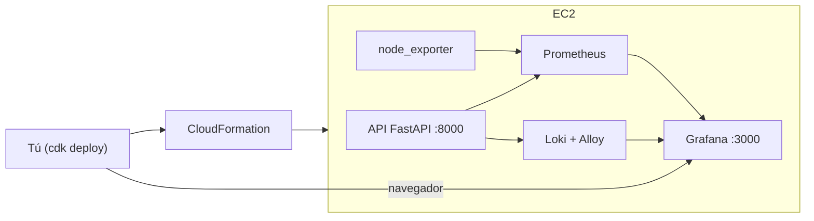

# Parte 1 — Métricas y Logs (CDK + Grafana)

Despliegas todo en AWS con **un solo comando de CDK**. La EC2 arranca sola e instala
Docker con todos los servicios (API, Prometheus, Loki, Grafana, node_exporter). Tú solo
entras a Grafana y creas dos dashboards: **CPU** y **respuestas de la API**.

> La Parte 2 (trazas con OpenTelemetry y Jaeger) está en
> [`02-trazas-distribuidas-opentelemetry-jaeger.md`](./02-trazas-distribuidas-opentelemetry-jaeger.md)
> y usa la **misma** instancia (no vuelves a desplegar).

---

## 1. Arquitectura (resumen)



**Grafana (3000)**, la **API (8000)** y **Jaeger (16686, Parte 2)** se exponen a tu IP. El
resto (Prometheus, Loki, OTel) queda interno.

---

## 2. Requisitos previos

- **AWS CLI** con un perfil configurado. Exporta el tuyo una sola vez para no repetirlo en
  cada comando (reemplaza `<tu-perfil>` por el nombre de tu perfil, p. ej. `default`):

  ```bash
  export AWS_PROFILE=<tu-perfil>
  aws sts get-caller-identity   # comprueba que apunta a tu cuenta
  ```
- **Node.js** y el CDK CLI: `npm install -g aws-cdk` (comprueba con `cdk --version`).
- **Python 3.12+**.

---

## 3. Desplegar con CDK

Desde la carpeta `cdk/`:

```bash
cd cdk
python3 -m venv .venv && source .venv/bin/activate
pip install -r requirements.txt

# (usa el perfil que exportaste en AWS_PROFILE; añade --profile <tu-perfil> si no lo exportaste)

# Solo la primera vez en la cuenta/región:
cdk bootstrap

# Despliega (acceso abierto a internet por defecto, lab educativo):
cdk deploy --require-approval never
```

> **Acceso.** Por defecto el lab abre Grafana, Jaeger y la API a todo internet
> (`0.0.0.0/0`) para que sea fácil de usar en clase. Si prefieres restringir a tu propia IP,
> añade `-c allowedCidr=$(curl -s https://checkip.amazonaws.com)/32` al comando.

**Resultado esperado:** al terminar (~3 min) CDK imprime las *Outputs*, entre ellas:

```
ObsLabStack.GrafanaUrl = http://<IP-PUBLICA>:3000
ObsLabStack.SsmSessionCommand = aws ssm start-session --target <ID>
```

Anota la `GrafanaUrl`. La EC2 sigue instalando los contenedores unos minutos más.

**Cómo comprobar que ya levantó todo** (reemplaza `<ID>` por el de la Output):

```bash
aws ssm start-session --target <ID>
# ya dentro de la instancia:
docker ps        # debes ver 9 contenedores "Up"
exit
```

Si `docker ps` aún no muestra todo, espera 1–2 min: el *user-data* sigue arrancando.

---

## 4. Entrar a Grafana

1. Abre en el navegador la `GrafanaUrl` (ej. `http://<IP-PUBLICA>:3000`).
2. Usuario `admin`, contraseña `changeme`.

> Con acceso abierto, **cambia la contraseña** de Grafana (menú de perfil → *Change
> password*) para que no quede expuesta con el valor por defecto.

---

## 5. Dashboard de CPU (paso a paso, muy detallado)

> `node_exporter` mide el **sistema operativo** de la EC2 (CPU, memoria, disco, red). **No
> es Amazon CloudWatch** (eso es un servicio aparte de AWS). Aquí todas las métricas de
> infraestructura vienen de `node_exporter`.

Antes de empezar, un mapa rápido de la pantalla de Grafana cuando editas un panel:
- **Menú lateral izquierdo** (iconos): desde ahí llegas a *Dashboards*.
- Al editar un panel verás **la gráfica arriba a la izquierda**, **el editor de consulta
  (query) abajo**, y **una columna de opciones a la derecha** con secciones plegables
  (*Panel options*, *Standard options*, etc.). La **unidad (Unit)** vive en esa columna.

### 5.1. Crear el dashboard y el primer panel

1. En el **menú lateral izquierdo**, haz clic en **Dashboards**.
2. Arriba a la derecha, botón azul **New** → **New dashboard**.
3. Verás una tarjeta grande que dice **Add visualization**. Haz clic en ella.
4. Grafana te pide elegir la fuente de datos (*data source*). Haz clic en **Prometheus**
   (ya viene preconfigurada en el lab). Se abre el **editor del panel**.

### 5.2. Escribir la consulta

5. Mira la parte **inferior** del editor: hay una pestaña **Query**. Debajo verás un campo
   de texto (el editor de consulta). Si está en modo "Builder", pulsa el botón **Code**
   (arriba a la derecha de ese recuadro) para escribir texto libre.
6. Borra lo que haya y **pega** exactamente esta consulta (uso de CPU en %):

   ```promql
   100 - (avg by(instance) (rate(node_cpu_seconds_total{mode="idle"}[5m])) * 100)
   ```

7. Pulsa el botón **Run queries** (o el icono de refрескar junto al editor). Arriba, en la
   gráfica, debería dibujarse una línea. Si dice *No data*, revisa el paso 7 (generar
   tráfico) o amplía el rango de tiempo (arriba a la derecha, p. ej. *Last 15 minutes*).

### 5.3. Ponerle tipo, unidad y título (la columna derecha)

8. **Tipo de panel:** arriba a la derecha de la gráfica hay un desplegable que normalmente
   dice **Time series**. Déjalo en **Time series**.
9. **Unidad (Unit) — aquí es donde se coloca:** en la **columna derecha**, busca la sección
   **Standard options** y haz clic para expandirla. El **primer campo es `Unit`**. Haz clic
   en él, escribe `percent` y elige **Percent (0-100)** (grupo *Misc*).
10. En esa misma sección **Standard options**, pon **Min = 0** y **Max = 100**.
11. **Título:** arriba del todo de la columna derecha, en la sección **Panel options**,
    campo **Title**: escribe `Uso de CPU (%)`.

### 5.4. Guardar

12. Arriba a la derecha, botón **Apply** (vuelve a la vista del dashboard).
13. Fija el refresco: arriba a la derecha del dashboard, junto al selector de tiempo, hay un
    desplegable de **auto-refresh**; elige **10s**.
14. Botón **Save dashboard** (icono de disquete, arriba a la derecha). Ponle el nombre
    **CPU de la instancia** y pulsa **Save**.

**Resultado esperado:** una gráfica con una línea del % de CPU. En reposo rondará un valor
bajo; subirá al generar tráfico (sección 7).

**Si falla:**
- *No data*: el target `node_exporter` puede tardar; genera tráfico (sección 7) y amplía el
  rango de tiempo. Si no, revisa la sección 11 (Troubleshooting).
- No encuentras **Unit**: asegúrate de estar **editando** el panel (no solo viéndolo) y de
  haber expandido **Standard options** en la columna derecha.

---

## 6. Dashboard de respuestas de la API (paso a paso)

Aquí crearás **un dashboard nuevo con varios paneles**. El procedimiento para CADA panel es
siempre el mismo (lo repites cambiando la consulta, el tipo y la unidad):

> **Receta para añadir un panel** (repítela por cada uno de abajo):
> 1. En el dashboard, arriba a la derecha, botón **Add** → **Visualization** (si es el
>    primer panel, usa la tarjeta **Add visualization**).
> 2. Fuente de datos: **Prometheus**.
> 3. Abajo, pestaña **Query**, modo **Code**, pega la consulta.
> 4. Pulsa **Run queries** para ver la gráfica.
> 5. Columna derecha: **Panel options → Title** (el nombre del panel).
> 6. Columna derecha: **Standard options → Unit** (la unidad indicada).
> 7. Si el panel usa leyenda `{{...}}`: en el editor de query, campo **Legend**, escribe
>    el texto indicado (p. ej. `{{route}}`).
> 8. Botón **Apply**.

### 6.1. Crear el dashboard

1. **Menú izquierdo → Dashboards → New → New dashboard**.
2. Para el primer panel, haz clic en **Add visualization** y elige **Prometheus**.

### 6.2. Panel 1 — Solicitudes por segundo

- **Tipo** (desplegable arriba de la gráfica): **Stat**.
- **Query** (modo Code):
  ```promql
  sum(rate(api_requests_total[5m]))
  ```
- **Standard options → Unit**: escribe `reqps` → **requests/sec (rps)** (grupo *Throughput*).
- **Title**: `Solicitudes por segundo`. → **Apply**.

### 6.3. Panel 2 — Solicitudes por endpoint

- **Tipo**: **Time series**.
- **Query**:
  ```promql
  sum by (route) (rate(api_requests_total[5m]))
  ```
- **Legend** (campo *Legend* del editor de query): `{{route}}`.
- **Unit**: `reqps`. **Title**: `Solicitudes por endpoint`. → **Apply**.

### 6.4. Panel 3 — Latencia p50 / p90 / p99

- **Tipo**: **Time series**. **Unit**: escribe `s` → **seconds (s)** (grupo *Time*).
- Este panel lleva **tres consultas** en el mismo panel. En el editor de query verás el
  botón **+ Query** (o *Add query*) para añadir filas. Añade tres y pega una en cada una,
  cambiando solo el número `0.50`, `0.90`, `0.99`:
  ```promql
  histogram_quantile(0.50, sum by (le) (rate(api_request_duration_seconds_bucket[5m])))
  ```
  ```promql
  histogram_quantile(0.90, sum by (le) (rate(api_request_duration_seconds_bucket[5m])))
  ```
  ```promql
  histogram_quantile(0.99, sum by (le) (rate(api_request_duration_seconds_bucket[5m])))
  ```
- **Title**: `Latencia (p50/p90/p99)`. → **Apply**.

### 6.5. Panel 4 — Códigos HTTP 2xx / 4xx / 5xx

- **Tipo**: **Time series**.
- **Query**:
  ```promql
  sum by (status_class) (rate(api_requests_by_status_class_total[5m]))
  ```
- **Legend**: `{{status_class}}`. **Unit**: `reqps`. **Title**: `Respuestas por clase HTTP`.
  → **Apply**.

### 6.6. Panel 5 — Tasa de error (5xx)

- **Tipo**: **Stat**.
- **Query**:
  ```promql
  100 * sum(rate(api_requests_by_status_class_total{status_class="5xx"}[5m]))
        / sum(rate(api_requests_total[5m]))
  ```
- **Unit**: escribe `percent` → **Percent (0-100)**. **Title**: `Tasa de error 5xx (%)`.
  → **Apply**.

### 6.7. Guardar el dashboard

- Botón **Save dashboard** (disquete, arriba a la derecha) → nombre **Respuestas de la API**
  → **Save**.

**Resultado esperado:** cinco paneles. Están "planos" hasta que generes tráfico (sección 7);
entonces verás subir las req/s, aparecer barras 4xx/5xx y moverse la latencia.

> **Atajo:** el lab ya trae estos dashboards provisionados automáticamente
> (`config/grafana/dashboards/`). Construirlos a mano es el ejercicio de aprendizaje; si solo
> quieres verlos, están en **Dashboards** sin crear nada.

> Ya hay dashboards equivalentes provisionados automáticamente
> (`config/grafana/dashboards/`). Este ejercicio es para que entiendas las consultas.

---

## 7. Generar tráfico y ver los dashboards moverse

Desde tu equipo, apuntando a la IP pública de la instancia:

```bash
cd scripts
python3 load_test.py --base-url http://<IP-PUBLICA>:8000 --duration 120
```

Genera llamadas con éxito, 404 y errores 500. **Resultado esperado:** en Grafana ves subir
las req/s, aparecen barras 4xx/5xx y la CPU sube.

---

## 8. Ver los logs (Loki)

En Grafana: **Explore → fuente Loki → ** consulta:

```logql
{service="obs-lab-api"}
```

**Resultado esperado:** logs JSON con `method`, `route`, `status` y `trace_id`. En la Parte
2 usarás ese `trace_id` para saltar a la traza en Jaeger.

---

## 9. Seguridad y puertos

| Puerto | Servicio | Acceso |
|---|---|---|
| 22 | SSH | Abierto (o usa SSM, sin llaves) |
| 3000 | Grafana | Abierto a internet (`0.0.0.0/0`) |
| 8000 | API | Abierto a internet |
| 16686 | Jaeger (trazas, Parte 2) | Abierto a internet |
| 9090/3100/4317 | Prometheus/Loki/OTel | **Cerrados** (internos; vía túnel SSM si hace falta) |

> Lab educativo: por defecto todo está abierto a internet. Es cómodo para clase pero deja
> Grafana (cambia su contraseña) y Jaeger (sin login) visibles para cualquiera. **Destruye
> el stack al terminar.** Para restringir a tu IP: `-c allowedCidr=<tu-ip>/32`.

---

## 10. Costes y limpieza

Mientras la EC2 esté encendida genera coste (~$15/mes si queda 24/7, + EBS + IP). Para
**apagar y dejar de pagar todo**:

```bash
cd cdk
cdk destroy
```

> Un simple *stop* de la EC2 **no** borra el disco EBS ni la IP: seguirían costando.
> `cdk destroy` elimina EC2 + EBS + IP + Security Group + IAM de una sola vez.

---

## 11. Si algo falla

- **Grafana no carga:** espera 1–2 min a que el user-data termine, y confirma que usas la
  IP de la Output `GrafanaUrl`.
- **`docker ps` incompleto:** el user-data sigue arrancando; espera 1–2 min. Logs:
  `sudo tail -f /var/log/cloud-init-output.log` (dentro de la instancia por SSM).
- **Panel "No data":** revisa en Prometheus (interno) que los *targets* estén `up`, o
  simplemente genera tráfico (paso 7) y amplía el rango de tiempo a "últimos 15 min".
