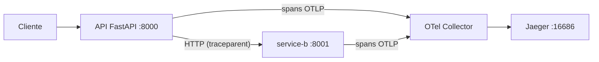

# Parte 2 — Trazas distribuidas (OpenTelemetry + Jaeger)

Continúa sobre la **misma** instancia que desplegaste en la Parte 1 (no vuelves a
desplegar nada). Aquí verás cómo **una sola petición** recorre dos servicios y cuánto
tarda en cada uno, usando OpenTelemetry y Jaeger.

---

## 1. Qué es cada cosa

- **Métrica** = número agregado (ej. req/s, % CPU). Responde "¿cuánto?".
- **Log** = evento con detalle en un instante. Responde "¿qué pasó?".
- **Traza** = el recorrido de **una** petición por varios servicios, con el tiempo de cada
  paso. Responde "¿dónde se tardó?".



El recorrido es `Cliente → API → service-b → respuesta`. Ambos servicios están
instrumentados con **OpenTelemetry**, propagan el contexto con la cabecera estándar
`traceparent`, y envían sus *spans* al **OTel Collector**, que los exporta a **Jaeger**.

> **¿Por qué Jaeger y no AWS X-Ray?** Jaeger corre en la misma EC2 que ya pagas (coste
> extra ≈ 0), es estándar abierto de OpenTelemetry y te da control total para un laboratorio.
> X-Ray es válido en producción, pero aquí añadiría coste y dependencia de AWS sin aportar
> al aprendizaje. En este lab la trazabilidad es 100% OpenTelemetry → Collector → Jaeger.

---

## 2. Abrir Jaeger (túnel SSM)

Jaeger (puerto 16686) está **cerrado a internet** por seguridad. Accedes por un túnel SSM.
Usa el `JaegerTunnelCommand` que CDK imprimió, o:

```bash
aws ssm start-session \
  --target <ID-INSTANCIA> \
  --document-name AWS-StartPortForwardingSession \
  --parameters '{"portNumber":["16686"],"localPortNumber":["16686"]}' \
  --profile stay
```

Déjalo corriendo y abre en el navegador: **http://localhost:16686**

**Resultado esperado:** la UI de Jaeger. En el desplegable *Service* verás
`obs-lab-api` y `obs-lab-service-b`.

---

## 3. Generar una traza

Haz una petición al endpoint que llama al segundo servicio (desde tu equipo):

```bash
curl "http://<IP-PUBLICA>:8000/checkout?slow=1"
```

`?slow=1` añade una latencia extra en `service-b` para que veas un cuello de botella claro.

---

## 4. Ver y entender la traza

1. En Jaeger: *Service* = `obs-lab-api`, *Operation* = `GET /checkout` → **Find Traces**.
2. Abre la traza más reciente.

**Resultado esperado:** una sola traza (un único `trace_id`) con varios spans en forma de
árbol, cruzando los dos servicios:

```
GET /checkout            (obs-lab-api)     ~1074 ms   ← raíz
  └─ GET                 (obs-lab-api)     ~1012 ms   ← llamada HTTP a service-b
       └─ GET /slow-process (obs-lab-service-b) ~1004 ms
            └─ service-b.work (obs-lab-service-b) ~1001 ms   ← aquí está la latencia
```

**Cómo confirmar que es una traza distribuida real (no spans sueltos):**

- Todos los spans comparten el **mismo `trace_id`** (arriba en el detalle de la traza).
- Hay relación **padre→hijo** entre los spans de `obs-lab-api` y los de `obs-lab-service-b`.
- En la vista de tiempos, el span más largo (`service-b.work` / `/slow-process`) te dice
  **qué servicio** causó la demora.

---

## 5. Correlacionar traza ↔ logs ↔ métricas

Flujo típico de investigación:

1. En el **dashboard de la API** (Parte 1) ves latencia o errores altos.
2. En **Explore → Loki** consultas `{service="obs-lab-api"}` y copias el `trace_id` del log
   de esa petición.
3. En **Jaeger** pegas ese `trace_id` en *Search by Trace ID* y abres la traza.
4. Identificas el span más lento → ese es el servicio responsable.

> La API ya incluye el `trace_id` en cada log JSON, y Grafana enlaza Loki ↔ Jaeger por ese
> campo (datasource Jaeger provisionado).

---

## 6. Si algo falla

- **No aparecen servicios en Jaeger:** haz primero un `curl .../checkout` (paso 3); Jaeger
  solo muestra servicios que ya enviaron spans.
- **El túnel SSM no abre:** confirma que el *Session Manager plugin* está instalado y que
  usas el `<ID-INSTANCIA>` correcto (Output `SsmSessionCommand`).
- **La traza tiene un solo span:** significa que el contexto no se propagó. Verifica que
  llamaste a `/checkout` (que invoca a `service-b`), no a un endpoint simple como `/health`.

---

## 7. Costes y limpieza

El segundo servicio, el Collector y Jaeger corren en la **misma EC2**: coste extra ≈ 0.
La limpieza es la misma de la Parte 1 (un solo comando elimina todo):

```bash
cd cdk
cdk destroy --profile stay -c allowedCidr=$(curl -s https://checkip.amazonaws.com)/32
```
