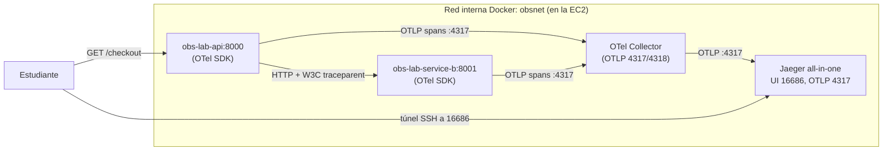

# Parte 2 — Trazas Distribuidas con OpenTelemetry y Jaeger

Segundo tutorial del laboratorio. Aquí añades **trazas distribuidas**: verás cómo una
sola petición HTTP atraviesa dos servicios (la API y un servicio descendente `service-b`)
y cuánto tiempo consume cada operación, todo visualizado en **Jaeger**.

> **Requisito:** completa primero la Parte 1
> ([`01-metricas-y-logs.md`](./01-metricas-y-logs.md)). Reutilizarás la **misma instancia
> EC2**, el mismo repositorio en `/home/ec2-user/obs-lab`, el mismo perfil `stay`
> (cuenta `550428926318`, usuario `arn:aws:iam::550428926318:user/JuanHoyos`, región
> `us-east-1`), el key pair `ec2-docker-api-key` y la etiqueta `Project=obs-lab`. **No**
> se crean recursos de AWS nuevos en esta parte: todo corre en contenedores dentro de la
> EC2 que ya tienes.

Cada paso indica: **qué se hace**, **por qué**, **el comando exacto**, **el directorio**,
el **resultado esperado**, **cómo comprobar** y **qué revisar si falla**. Los bloques
"Resultado esperado" describen lo que deberías ver; no son salidas copiadas de una
ejecución real.

---

## Índice

1. [Objetivos de aprendizaje](#1-objetivos-de-aprendizaje)
2. [Arquitectura de trazas](#2-arquitectura-de-trazas)
3. [Diferencias entre métrica, log y traza](#3-diferencias-entre-métrica-log-y-traza)
4. [Diseño del recorrido de la petición](#4-diseño-del-recorrido-de-la-petición)
5. [El segundo servicio `service-b` (Alternativa B vs. Lambda)](#5-el-segundo-servicio-service-b-alternativa-b-vs-lambda)
6. [Instrumentación con OpenTelemetry](#6-instrumentación-con-opentelemetry)
7. [Propagación de contexto (W3C traceparent)](#7-propagación-de-contexto-w3c-traceparent)
8. [Configuración del OTel Collector](#8-configuración-del-otel-collector)
9. [Despliegue de Jaeger](#9-despliegue-de-jaeger)
10. [Activar OTLP y arrancar el stack con tracing](#10-activar-otlp-y-arrancar-el-stack-con-tracing)
11. [Ejecución de peticiones de prueba](#11-ejecución-de-peticiones-de-prueba)
12. [Análisis de trazas y spans en Jaeger](#12-análisis-de-trazas-y-spans-en-jaeger)
13. [Simulación de latencia y errores](#13-simulación-de-latencia-y-errores)
14. [Correlación logs ↔ métricas ↔ trazas](#14-correlación-logs--métricas--trazas)
15. [Verificación](#15-verificación)
16. [Troubleshooting](#16-troubleshooting)
17. [Seguridad y costes adicionales](#17-seguridad-y-costes-adicionales)
18. [Limpieza de los recursos adicionales](#18-limpieza-de-los-recursos-adicionales)

---

## 1. Objetivos de aprendizaje

Al terminar esta parte sabrás:

- Distinguir con criterio una **métrica**, un **log** y una **traza**, y cuándo usar cada
  una.
- Instrumentar dos servicios con **OpenTelemetry** y exportar sus trazas por **OTLP**.
- Entender la **propagación de contexto W3C `traceparent`** que hace que dos servicios
  compartan un mismo `trace_id` con spans padre-hijo.
- Visualizar en **Jaeger** cómo una petición `Client → api → service-b` reparte el tiempo
  entre operaciones y localizar un cuello de botella.
- **Correlacionar** las tres señales: detectar una anomalía en las métricas de la API,
  inspeccionar los logs en Loki y abrir la traza relacionada en Jaeger.

---

## 2. Arquitectura de trazas

Se añaden tres piezas al stack de la Parte 1: el servicio **`service-b`**, el **OTel
Collector** y **Jaeger**. Todo sigue en la red interna `obsnet`; nada nuevo se expone a
Internet (Jaeger UI y el collector son internos, se consultan por túnel SSH).



- La API recibe `GET /checkout` y llama por HTTP a `service-b`.
- Ambos servicios exportan sus **spans** por OTLP gRPC al **OTel Collector**
  (`otel-collector:4317`).
- El Collector procesa (memory_limiter, resource, batch) y reexporta por **OTLP** a
  **Jaeger** (`jaeger:4317`).
- Tú abres la **UI de Jaeger** (16686) por túnel SSH para ver la traza completa.

---

## 3. Diferencias entre métrica, log y traza

**Qué se hace:** fijar el concepto antes de implementar.

**Por qué:** las tres señales se complementan; confundirlas lleva a instrumentar mal.

| Señal | Qué responde | Granularidad | Ejemplo en este lab |
|-------|--------------|--------------|---------------------|
| **Métrica** | "¿Cuánto / con qué frecuencia?" (agregados numéricos en el tiempo) | Agregada, barata de almacenar | `api_requests_total`, p99 de latencia |
| **Log** | "¿Qué pasó exactamente en este evento?" | Un evento discreto, con contexto | Línea JSON con `status=500` y `correlation_id` |
| **Traza** | "¿Por dónde pasó la petición y dónde se fue el tiempo?" | Una petición de punta a punta, repartida en spans | Traza `/checkout` con spans de api y service-b |

Regla práctica: una **métrica** te dice *que* algo va mal (sube la tasa de 5xx o la
latencia); un **log** te da el detalle de un evento concreto; una **traza** te dice *dónde*
dentro del recorrido se fue el tiempo o se produjo el error.

**Resultado esperado:** poder explicar por qué, ante un pico de latencia, abrirías la
traza para ver qué servicio la causó.

---

## 4. Diseño del recorrido de la petición

**Qué se hace:** definir el camino que seguirá una petición para producir una traza
distribuida real.

**Por qué:** una traza "distribuida" exige que la petición cruce al menos dos servicios y
que el contexto se propague entre ellos.

Recorrido implementado:

```
Client ─▶ obs-lab-api  GET /checkout
                 │  (httpx auto-instrumentado inyecta traceparent)
                 ▼
          obs-lab-service-b  GET /process  (o /slow-process si ?slow=1)
                 │
                 ▼
          service-b.work  (span manual: el "trabajo" interno)
```

- `GET /checkout` → la API llama a `service-b` en `/process`.
- `GET /checkout?slow=1` → la API llama a `service-b` en `/slow-process`, que inyecta
  latencia acotada para simular un cuello de botella.

**Resultado esperado:** una sola petición genera **un único `trace_id`** con spans
padre-hijo repartidos entre `obs-lab-api` y `obs-lab-service-b`.

**Cómo comprobar:** ver [sección 12](#12-análisis-de-trazas-y-spans-en-jaeger).

---

## 5. El segundo servicio `service-b` (Alternativa B vs. Lambda)

**Qué se hace:** entender el segundo servicio y por qué se eligió un contenedor y no una
función Lambda.

**Por qué:** necesitamos un segundo componente para que la traza sea realmente
distribuida. Había dos alternativas; elegimos la **Alternativa B** (un segundo
microservicio FastAPI en contenedor).

### 5.1. Comparación Lambda vs. contenedor `service-b`

| Criterio | Alternativa A: AWS Lambda | **Alternativa B (elegida): contenedor `service-b`** |
|----------|---------------------------|-----------------------------------------------------|
| Instrumentación OTel | Requiere la **capa ADOT** (AWS Distro for OpenTelemetry) y a menudo **propagación manual** del contexto | Auto-instrumentación FastAPI estándar; traceparent se propaga solo |
| Endpoint del Collector | Necesita un **endpoint OTLP público y seguro** (TLS, auth) para que Lambda exporte desde fuera de la EC2 | El Collector es **interno** a `obsnet`; **no** se expone a Internet |
| Coste | **Coste por invocación** + posible NAT/salida a Internet | **~0 coste extra**: reutiliza la EC2 que ya pagas |
| Complejidad de red | Lambda fuera de la VPC o con VPC + NAT para alcanzar el Collector | Todo en la red interna de Docker, sin red adicional |
| Encaje con el lab | Añade superficie y piezas gestionadas | Mínimo cambio: un contenedor más junto a la API |

**Conclusión:** la Alternativa B (contenedor `service-b`) da una traza distribuida real
con **~0 coste adicional**, **sin exponer** un endpoint OTLP público y con la
instrumentación más simple. Por eso es la elegida. Lambda es didácticamente válida pero
añade coste por invocación, una capa ADOT, propagación manual de contexto y un endpoint
público seguro para el Collector, que no aportan al objetivo del laboratorio.

### 5.2. Qué hace `service-b`

Vive en `service-b/` (ver `service-b/main.py`). Sirve en `0.0.0.0:8001` (interno, sin
puerto publicado) y expone:

| Endpoint | Qué hace | Nota |
|----------|----------|------|
| `GET /health` | Salud. | 200 |
| `GET /process` | Trabajo descendente corto y acotado (~0.05 s). | 200 |
| `GET /slow-process?seconds=<=5>` | Trabajo con latencia extra (por defecto 1.0 s) para demostrar un cuello de botella. | 200 |
| `GET /metrics` | Exposición Prometheus (hace que el *scrape* `service-b` de la Parte 1 pase a `UP`). | 200 |

El trabajo interno vive dentro de **un único span manual** llamado `service-b.work` (en la
función `_do_work`), que **no** duplica el span automático del handler HTTP de FastAPI.

**Resultado esperado:** `service-b` arriba e interno; su `/metrics` hace que el target
`service-b` de Prometheus pase a `UP`.

**Cómo comprobar:** `docker compose ps` lista `obs-lab-service-b` en `Up`.

**Qué revisar si falla:** `docker compose logs service-b`; confirma que la imagen
`obs-lab-service-b:1.0.0` se construyó.

---

## 6. Instrumentación con OpenTelemetry

**Qué se hace:** entender cómo ambos servicios producen spans.

**Por qué:** sin instrumentación no hay trazas.

Ambos servicios usan el **OpenTelemetry SDK 1.27.0** con instrumentación `0.48b0`:

- **API** (`app/otel.py`): `TracerProvider` con `service.name=obs-lab-api`, exportador
  **OTLP gRPC** a `OTEL_EXPORTER_OTLP_ENDPOINT` (por defecto `http://otel-collector:4317`),
  `BatchSpanProcessor`, auto-instrumentación de **FastAPI** y de **httpx** (clave: instrumenta
  las llamadas salientes para propagar el contexto). No añade spans manuales alrededor de la
  llamada httpx para no duplicar el span automático del cliente.
- **service-b** (`service-b/otel.py`): igual, con `service.name=obs-lab-service-b`,
  auto-instrumentación de FastAPI y **un** span manual `service-b.work`.

La instrumentación está **condicionada por la variable `OTEL_ENABLED`**: si no es
verdadera, `setup_otel()` es un *no-op* y el stack funciona igual (comportamiento de la
Parte 1). Para trazas hay que ponerla a `true` (ver [sección 10](#10-activar-otlp-y-arrancar-el-stack-con-tracing)).

> **Detalle de dependencias (ya resuelto en el repo):** la instrumentación `0.48b0`
> importa `pkg_resources` en tiempo de ejecución, y `python:3.12-slim` ya no incluye
> `setuptools`. Por eso `app/requirements.txt` y `service-b/requirements.txt` fijan
> `setuptools==75.*`. Sin ello, el tracing se desactivaría silenciosamente y el `trace_id`
> saldría vacío.

**Resultado esperado:** con `OTEL_ENABLED=true`, el log de arranque de cada servicio dice
que exporta spans al endpoint del collector.

**Cómo comprobar:** `docker compose logs api | grep -i opentelemetry` muestra "OpenTelemetry
enabled; exporting spans to http://otel-collector:4317".

**Qué revisar si falla:** si ves "tracing disabled (no-op)", `OTEL_ENABLED` no está en
`true` (revisa tu `.env`).

---

## 7. Propagación de contexto (W3C traceparent)

**Qué se hace:** entender cómo api y service-b terminan en la **misma** traza.

**Por qué:** una traza distribuida requiere pasar el contexto de un servicio al siguiente.

Cuando la API llama a `service-b`, la auto-instrumentación de **httpx** inyecta en la
petición saliente el header estándar **`traceparent`** (formato W3C Trace Context), que
lleva el `trace_id` y el id del span padre. Al recibirla, la auto-instrumentación de
FastAPI en `service-b` **extrae** ese header y continúa la misma traza: los spans de
`service-b` se vuelven **hijos** del span de la API.

No tienes que escribir código de propagación: ocurre automáticamente porque la API
instrumenta httpx y service-b instrumenta FastAPI.

**Resultado esperado:** un único `trace_id` compartido; en Jaeger, el span de service-b
cuelga del span de la API.

**Cómo comprobar:** en Jaeger, al abrir una traza de `/checkout`, el árbol muestra el span
de la API como raíz y los de service-b anidados debajo (ver [sección 12](#12-análisis-de-trazas-y-spans-en-jaeger)).

**Qué revisar si falla:** si ves **dos trazas separadas** en vez de una, la propagación no
ocurrió: confirma que la API tiene la auto-instrumentación de httpx activa (está en
`app/otel.py`) y que `OTEL_ENABLED=true` en **ambos** servicios.

---

## 8. Configuración del OTel Collector

**Qué se hace:** entender cómo el Collector recibe los spans y los reenvía a Jaeger.

**Por qué:** el Collector centraliza, procesa y protege la exportación de telemetría.

Configuración en `config/otel/otel-collector-config.yml` (imagen
`otel/opentelemetry-collector-contrib:0.109.0`):

- **receivers.otlp**: `grpc` en `0.0.0.0:4317` y `http` en `0.0.0.0:4318` (recibe de api y
  service-b).
- **processors**:
  - `memory_limiter` (`check_interval: 1s`, `limit_mib: 256`, `spike_limit_mib: 64`) para
    proteger la `t3.small` de picos de memoria.
  - `resource` (upsert de `collector.name=obs-lab-otel-collector`).
  - `batch` (`timeout: 5s`, `send_batch_size: 512`) para agrupar exportaciones.
- **exporters.otlp**: envía a `jaeger:4317` con `tls.insecure: true` (red interna).
- **pipeline traces**: `otlp (receiver) → [memory_limiter, resource, batch] → otlp (exporter)`.

> **Importante — no hay exportador nativo de Jaeger.** En el Collector contrib 0.109 el
> antiguo exportador `jaeger` **fue eliminado**. Por eso exportamos a Jaeger usando el
> exportador **`otlp`** apuntando a `jaeger:4317`. Jaeger acepta OTLP solo si se arranca con
> `COLLECTOR_OTLP_ENABLED=true` (ver [sección 9](#9-despliegue-de-jaeger)).

**Resultado esperado:** el Collector arranca sin error de configuración y sus logs indican
nivel `info`.

**Cómo comprobar:** `docker compose logs otel-collector` no muestra errores de parseo ni de
exportador desconocido.

**Qué revisar si falla:**
- Error "unknown exporter 'jaeger'": estás usando una config antigua; usa el exportador
  `otlp` a `jaeger:4317` (como en el repo).
- Memoria: si el collector reinicia por OOM, confirma que usas `t3.small` y el
  `memory_limiter`.

---

## 9. Despliegue de Jaeger

**Qué se hace:** entender el servicio Jaeger y cómo acepta OTLP.

**Por qué:** Jaeger almacena y visualiza las trazas.

En `docker-compose.yml`, el servicio `jaeger` usa la imagen `jaegertracing/all-in-one:1.60`
con la variable de entorno **`COLLECTOR_OTLP_ENABLED=true`**, imprescindible para que Jaeger
acepte OTLP en `4317` (gRPC) y `4318` (HTTP). La **UI** está en `16686` y es **interna**: se
accede por túnel SSH (no se expone en el Security Group).

La fuente de datos de Jaeger en Grafana (uid `jaeger`, `http://jaeger:16686`) ya se
aprovisionó en la Parte 1; ahora que el servicio existe, su "health check" pasará a verde.

**Resultado esperado:** `obs-lab-jaeger` arriba; la UI responde por túnel en
`http://localhost:16686`.

**Cómo comprobar:** `docker compose ps` lista `obs-lab-jaeger` en `Up`; con el túnel, la UI
carga.

**Qué revisar si falla:** si Jaeger rechaza las trazas, confirma que
`COLLECTOR_OTLP_ENABLED=true` está en el entorno del servicio `jaeger`.

---

## 10. Activar OTLP y arrancar el stack con tracing

**Qué se hace:** encender el tracing y levantar el stack completo.

**Por qué:** el tracing está apagado por defecto; hay que ponerlo a `true`.

**Comando exacto** (dentro de la EC2, directorio `/home/ec2-user/obs-lab`). Edita el `.env`
para activar OTel y arranca:

```bash
# Asegúrate de que .env existe (de la Parte 1) y pon OTEL_ENABLED=true.
grep -q '^OTEL_ENABLED=' .env && sed -i 's/^OTEL_ENABLED=.*/OTEL_ENABLED=true/' .env || echo 'OTEL_ENABLED=true' >> .env

docker compose config            # valida (ahora con otel-collector y jaeger)
docker compose build             # construye api y service-b
docker compose up -d             # levanta el stack completo
docker compose ps
```

El `.env.example` ya documenta `OTEL_ENABLED` y
`OTEL_EXPORTER_OTLP_ENDPOINT=http://otel-collector:4317`.

**Resultado esperado:** `docker compose ps` lista también `obs-lab-service-b`,
`obs-lab-otel-collector` y `obs-lab-jaeger` en `Up`, junto a los servicios de la Parte 1.

**Cómo comprobar:** `docker compose logs api | grep -i "OpenTelemetry enabled"` aparece en
api y service-b.

**Qué revisar si falla:**
- Sigue en no-op: `OTEL_ENABLED` no quedó en `true`; revisa el `.env` y recrea con
  `docker compose up -d`.
- `service-b` o `jaeger` no arrancan: revisa sus logs con `docker compose logs <servicio>`.

---

## 11. Ejecución de peticiones de prueba

**Qué se hace:** generar peticiones que crucen ambos servicios.

**Por qué:** sin peticiones a `/checkout` no hay trazas distribuidas que ver.

**Comando exacto** (dentro de la EC2, directorio `/home/ec2-user/obs-lab`):

```bash
# Petición normal (api -> service-b /process).
curl -s http://localhost:8000/checkout | python3 -m json.tool

# Petición lenta (api -> service-b /slow-process), para ver el cuello de botella.
curl -s "http://localhost:8000/checkout?slow=1" | python3 -m json.tool
```

También puedes generar tráfico sostenido con el script de la Parte 1 (que incluye `/`,
`/products`, errores y lentitud); para ejercitar `/checkout` de forma repetida:

```bash
for i in $(seq 1 20); do curl -s "http://localhost:8000/checkout?slow=$((i % 2))" >/dev/null; done
```

**Resultado esperado:** cada `curl` devuelve un JSON con `"service": "obs-lab-api"`,
`"operation": "checkout"` y un objeto `downstream` producido por service-b. La variante
`?slow=1` tarda visiblemente más (alrededor de 1 s).

**Cómo comprobar:** la respuesta `?slow=1` tarda del orden de un segundo más que la normal.

**Qué revisar si falla:**
- `connection refused`: la API no está arriba (dentro de la EC2 usa `localhost:8000`).
- `502/500` desde `/checkout`: service-b no responde; revisa `docker compose logs service-b`.

---

## 12. Análisis de trazas y spans en Jaeger

**Qué se hace:** abrir Jaeger y confirmar que una petición produce una sola traza con spans
padre-hijo en ambos servicios.

**Por qué:** es la evidencia de que el tracing distribuido funciona.

**Comando exacto — túnel SSH a la UI de Jaeger** (desde tu máquina local, directorio donde
está el `.pem`):

```bash
ssh -i ec2-docker-api-key.pem -L 16686:localhost:16686 ec2-user@"$EC2_IP"
```

Con el túnel abierto, en tu navegador local abre `http://localhost:16686`.

**Pasos en la UI:**

1. En **Service** elige `obs-lab-api` y pulsa **Find Traces**.
2. Abre una traza de `GET /checkout`.
3. Confirma el árbol de spans. Para la variante `?slow=1` deberías ver una jerarquía del
   tipo:

```
obs-lab-api: GET /checkout                 (span raíz)
  └─ obs-lab-api: GET                       (span cliente httpx)
       └─ obs-lab-service-b: GET /slow-process   (hijo => traceparent propagado)
            └─ obs-lab-service-b: service-b.work  (span manual con la latencia inyectada)
```

**Cómo comprobar que dos servicios comparten un `trace_id`:**

- En el panel superior de la traza, el `Trace ID` es **único** para toda la petición.
- El árbol muestra spans etiquetados con **ambos** nombres de servicio (`obs-lab-api` y
  `obs-lab-service-b`), y los de service-b están **anidados** bajo el span de la API (son
  hijos). Eso confirma la relación padre-hijo vía `traceparent`.
- En **Search → Service** deben aparecer los dos servicios en la lista.

**Resultado esperado:** una sola traza con 4 spans (en el camino `?slow=1`), repartidos
entre api y service-b, con el tiempo concentrado en `service-b.work`.

**Qué revisar si falla:**
- Jaeger no lista `obs-lab-service-b`: no llegó ninguna traza de service-b; revisa que
  `OTEL_ENABLED=true` en service-b y los logs del collector.
- Ves dos trazas en vez de una: la propagación no funcionó (ver [sección 7](#7-propagación-de-contexto-w3c-traceparent)).

---

## 13. Simulación de latencia y errores

**Qué se hace:** usar las rutas controladas para producir latencia y errores observables en
las tres señales.

**Por qué:** aprender a reconocer un problema y a seguirlo hasta su origen.

- **Latencia:** `GET /checkout?slow=1` enruta a `service-b /slow-process`, cuyo span
  `service-b.work` concentra ~1 s. En Jaeger ese span aparece claramente más largo que el
  resto: ahí está el cuello de botella.
- **Errores:** usa los endpoints de la API de la Parte 1 para generar errores
  reproducibles:
  ```bash
  curl -s -o /dev/null -w "%{http_code}\n" "http://localhost:8000/simulate-error?mode=server"  # 500
  curl -s -o /dev/null -w "%{http_code}\n" "http://localhost:8000/simulate-error?mode=client"  # 400
  curl -s -o /dev/null -w "%{http_code}\n" "http://localhost:8000/products/999"                 # 404
  ```

**Resultado esperado:** los códigos impresos son `500`, `400` y `404`; en el dashboard de la
API suben los contadores 4xx/5xx y la tasa de errores, y en Jaeger la traza lenta muestra el
span largo en service-b.

**Cómo comprobar:** cruza lo que ves en el dashboard de la API (Parte 1) con la traza lenta
en Jaeger.

**Qué revisar si falla:** si `/simulate-error?mode=server` no devuelve 500, revisa
`app/main.py` (el comportamiento de `simulate_error`).

---

## 14. Correlación logs ↔ métricas ↔ trazas

**Qué se hace:** recorrer de punta a punta una investigación usando las tres señales.

**Por qué:** es el objetivo final de la observabilidad: pasar del "algo va mal" al "esto es
lo que lo causó".

El pegamento ya está provisionado en Grafana (Parte 1):

- Los logs JSON de la API incluyen el campo `trace_id` (poblado cuando `OTEL_ENABLED=true`).
- La fuente **Loki** tiene un *derived field* con la regex
  `"trace_id"\s*:\s*"([a-f0-9]+)"` que convierte ese `trace_id` en un **enlace a Jaeger**.
- La fuente **Jaeger** tiene `tracesToLogsV2` que enlaza **desde un span de vuelta a Loki**
  (etiqueta `service.name` → valor `service`).

**Recorrido de investigación (end-to-end):**

1. **Métrica → sospecha.** En el **dashboard de la API** (Grafana) detectas una anomalía:
   sube el p99 de latencia o la tasa de 5xx en una ventana de tiempo. Anota esa ventana.
2. **Log → detalle.** Ve a **Explore → Loki** y filtra en esa ventana:
   ```
   {service="obs-lab-api"} | json | status >= 500
   ```
   o, para la latencia, ordena por `duration_ms`. Abre una línea sospechosa: contiene
   `correlation_id` y `trace_id`.
3. **Traza → causa raíz.** En esa línea de log, haz clic en el enlace del campo derivado
   `trace_id`: Grafana abre la **traza en Jaeger**. Inspecciona el árbol de spans y localiza
   cuál servicio y operación consumió el tiempo o produjo el error (por ejemplo,
   `service-b.work` en el camino lento).
4. **Vuelta (opcional).** Desde el span en Jaeger, usa el enlace *traces to logs* para
   volver a los logs de Loki de ese mismo servicio y confirmar el contexto.

**Resultado esperado:** desde un pico en una gráfica llegas, en pocos clics, a la traza
exacta y al span que explica el problema, cerrando el ciclo métrica → log → traza.

**Cómo comprobar:** el enlace del `trace_id` en Loki abre una traza real en Jaeger (no un
error "trace not found") y el `trace_id` del log coincide con el `Trace ID` de la UI de
Jaeger.

**Qué revisar si falla:**
- `trace_id` vacío en los logs: `OTEL_ENABLED` no está en `true`; sin traza activa el campo
  queda vacío (ver `current_trace_id()` en `app/otel.py`).
- El enlace de Loki no resuelve en Jaeger: confirma que la traza existe (puede tardar unos
  segundos por el `batch` del collector) y que las UIDs de las fuentes son `loki`/`jaeger`.

---

## 15. Verificación

**Qué se hace:** confirmar los criterios de aceptación de la Parte 2.

**Por qué:** cierre de la parte de trazas.

| Verificación | Comando / acción | Resultado esperado |
|--------------|------------------|--------------------|
| Compose válido con las piezas nuevas | `docker compose config` | YAML resuelto sin error, con otel-collector y jaeger |
| Stack completo arriba | `docker compose up -d && docker compose ps` | api, service-b, otel-collector, jaeger (y los de Parte 1) en `Up` |
| Traza distribuida | `curl -s http://localhost:8000/checkout >/dev/null`, luego Jaeger | Una sola traza con spans padre-hijo de ambos servicios |
| Latencia visible | `curl -s "http://localhost:8000/checkout?slow=1" >/dev/null`, luego Jaeger | El span de service-b aparece más largo |
| `trace_id` en logs | Explore → Loki `{service="obs-lab-api"}` | Las líneas de `/checkout` traen `trace_id` no vacío |
| Correlación Loki ↔ Jaeger | Clic en el campo derivado `trace_id` | Abre la traza correspondiente en Jaeger |
| Target service-b en Prometheus | `/targets` (por túnel) | `service-b` ahora `UP` |

**Qué revisar si falla:** vuelve a la sección del componente implicado (collector 8, jaeger
9, propagación 7) y revisa sus logs con `docker compose logs <servicio>`.

---

## 16. Troubleshooting

| Síntoma | Causa probable | Qué revisar / cómo arreglar |
|---------|----------------|-----------------------------|
| No aparecen trazas en Jaeger | `OTEL_ENABLED` apagado | Pon `OTEL_ENABLED=true` en `.env` y recrea con `docker compose up -d` |
| Dos trazas separadas en vez de una | No se propagó `traceparent` | Confirma auto-instrumentación de httpx en api y FastAPI en service-b, ambas con tracing on |
| Collector reinicia | OOM o config inválida | Usa `t3.small`; revisa `docker compose logs otel-collector` (exportador `otlp`, no `jaeger`) |
| Jaeger no recibe OTLP | Falta `COLLECTOR_OTLP_ENABLED=true` | Revisa el entorno del servicio `jaeger` en `docker-compose.yml` |
| `trace_id` vacío en logs | Tracing en no-op o sin span activo | `OTEL_ENABLED=true`; verifica el log "OpenTelemetry enabled" |
| No puedo abrir la UI 16686 | No hay túnel SSH (es interno) | Abre `ssh -L 16686:localhost:16686 …`; nunca expongas 16686 en el SG |
| Enlace Loki→Jaeger no resuelve | Traza aún no exportada (batch) o UIDs | Espera unos segundos; confirma UIDs `loki`/`jaeger` |

---

## 17. Seguridad y costes adicionales

**Qué se hace:** evaluar la seguridad y el coste de lo añadido en la Parte 2.

**Por qué:** mantener el laboratorio seguro y económico.

**Seguridad:**

- `service-b` (8001), el **OTel Collector** (4317/4318) y la **UI de Jaeger** (16686) son
  **internos** a `obsnet`; **no** se abren en el Security Group. La UI de Jaeger se consulta
  por **túnel SSH**, igual que Prometheus/Loki en la Parte 1.
- El Collector exporta a Jaeger por la red interna con TLS deshabilitado (`tls.insecure`),
  aceptable porque el tráfico no sale de la instancia.
- No se registran credenciales ni tokens; los spans no deben llevar datos sensibles.
- Al elegir la Alternativa B (contenedor) **no** necesitas un endpoint OTLP público, lo que
  evita exponer superficie a Internet (una de las razones para descartar Lambda).

**Costes adicionales:**

- `service-b`, el OTel Collector y Jaeger corren como **contenedores en la misma EC2** que
  ya pagas: **~0 coste adicional** de AWS. No añaden instancias, ni NAT, ni balanceadores,
  ni invocaciones (a diferencia de la alternativa Lambda).
- El consumo extra de memoria se controla con el `memory_limiter` (256 MiB) del Collector,
  encajando en la `t3.small` de 2 GiB.

**Resultado esperado:** la factura de la Parte 2 es esencialmente la misma que la de la
Parte 1 (ver [estimación de costes de la Parte 1](./01-metricas-y-logs.md#18-estimación-de-costes)).

**Cómo comprobar:** en **Billing → Cost Explorer** filtrando por `Project=obs-lab`, no
aparecen cargos nuevos por servicios gestionados.

**Qué revisar si falla (coste inesperado):** confirma que no creaste por error recursos
gestionados (Lambda, NAT, ALB); esta parte solo añade contenedores locales.

---

## 18. Limpieza de los recursos adicionales

**Qué se hace:** la Parte 2 **no** crea recursos de AWS nuevos, así que la limpieza
coincide con la de la Parte 1.

**Por qué:** todo lo añadido son contenedores dentro de la EC2 existente.

**Comando exacto** (dentro de la EC2, directorio `/home/ec2-user/obs-lab`):

```bash
docker compose down            # detiene api, service-b, collector, jaeger y el resto
# docker compose down -v        # añade -v para borrar también los volúmenes de datos
```

Para eliminar la infraestructura de AWS (instancia, EBS, Security Group, IAM role) sigue la
sección de **limpieza y eliminación segura** de la Parte 1:
[`01-metricas-y-logs.md` → sección 19](./01-metricas-y-logs.md#19-limpieza-y-eliminación-segura-de-recursos).
Recuerda **terminar** la instancia y **borrar** volúmenes/IP para dejar de pagar: apagar
(`stop`) la EC2 no elimina los costes de EBS ni de la IP pública. No toques recursos ajenos
(`soc-challenge-*`, `SocChallenge-*`, `lumen-production-*`).

**Resultado esperado:** `docker compose down` deja la EC2 sin contenedores del laboratorio;
la limpieza de AWS la gobierna la Parte 1.

**Cómo comprobar:** `docker compose ps` no lista ningún contenedor del laboratorio.

**Qué revisar si falla:** si un contenedor queda "colgado", `docker compose down --remove-orphans`.

---

Con esto cierras el laboratorio: **métricas** (Parte 1), **logs** (Parte 1) y **trazas
distribuidas** (Parte 2), correlacionadas de punta a punta en Grafana y Jaeger. Vuelve a la
Parte 1 si necesitas repasar el despliegue de la EC2:
[`01-metricas-y-logs.md`](./01-metricas-y-logs.md).
