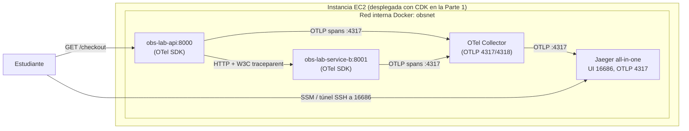

# Parte 2 — Trazas Distribuidas con OpenTelemetry y Jaeger

Segundo tutorial del laboratorio. Aquí exploras **trazas distribuidas**: verás cómo una
sola petición HTTP atraviesa dos servicios (la API y un servicio descendente `service-b`)
y cuánto tiempo consume cada operación, todo visualizado en **Jaeger**.

> **Requisito:** completa primero la Parte 1
> ([`01-metricas-y-logs.md`](./01-metricas-y-logs.md)). Reutilizarás la **misma
> infraestructura ya desplegada con CDK**: la misma instancia EC2, el mismo stack
> `ObsLabStack`, el mismo perfil `stay` (cuenta `550428926318`, usuario
> `arn:aws:iam::550428926318:user/JuanHoyos`, región `us-east-1`), el key pair
> `ec2-docker-api-key` y la etiqueta `Project=obs-lab`. **No** vuelves a ejecutar
> `cdk deploy` ni creas recursos nuevos: `service-b`, el OTel Collector y Jaeger ya
> arrancaron junto al resto del stack porque el *user-data* escribió `OTEL_ENABLED=true` en
> el `.env` de la instancia.

Cada paso indica: **qué se hace**, **por qué**, **el comando exacto**, **el directorio**,
el **resultado esperado**, **cómo comprobar** y **qué revisar si falla**. Los bloques
"Resultado esperado" describen lo que deberías ver; **no** son salidas copiadas de una
ejecución real.

---

## Índice

1. [Objetivos de aprendizaje](#1-objetivos-de-aprendizaje)
2. [Arquitectura de trazas](#2-arquitectura-de-trazas)
3. [Diferencias entre métrica, log y traza](#3-diferencias-entre-métrica-log-y-traza)
4. [Por qué OpenTelemetry + Jaeger y no X-Ray](#4-por-qué-opentelemetry--jaeger-y-no-x-ray)
5. [Diseño del recorrido y el servicio `service-b`](#5-diseño-del-recorrido-y-el-servicio-service-b)
6. [Instrumentación con OpenTelemetry (y propagación W3C)](#6-instrumentación-con-opentelemetry-y-propagación-w3c)
7. [Configuración del OTel Collector](#7-configuración-del-otel-collector)
8. [Acceder a Jaeger (SSM port-forward o túnel SSH a 16686)](#8-acceder-a-jaeger-ssm-port-forward-o-túnel-ssh-a-16686)
9. [Ejecutar peticiones `/checkout`](#9-ejecutar-peticiones-checkout)
10. [Explorar la traza en Jaeger](#10-explorar-la-traza-en-jaeger)
11. [Correlación métricas → logs → trazas](#11-correlación-métricas--logs--trazas)
12. [Verificación](#12-verificación)
13. [Troubleshooting](#13-troubleshooting)
14. [Seguridad y costes adicionales](#14-seguridad-y-costes-adicionales)
15. [Limpieza de recursos adicionales](#15-limpieza-de-recursos-adicionales)

---

## 1. Objetivos de aprendizaje

Al terminar esta parte sabrás:

- Distinguir con criterio una **métrica**, un **log** y una **traza**, y cuándo usar cada
  una.
- Entender cómo dos servicios instrumentados con **OpenTelemetry** exportan sus trazas por
  **OTLP** al OTel Collector y de ahí a **Jaeger**.
- Entender la **propagación de contexto W3C `traceparent`** que hace que dos servicios
  compartan un mismo `trace_id` con spans padre-hijo.
- Acceder a la **UI de Jaeger** (interna) de forma segura por **SSM port-forward** o túnel
  SSH y explorar cómo una petición `Cliente → api → service-b` reparte el tiempo.
- **Correlacionar** las tres señales: detectar una anomalía en las métricas de la API,
  inspeccionar los logs en Loki y abrir la traza relacionada en Jaeger.

---

## 2. Arquitectura de trazas

Tres piezas del stack participan en las trazas: el servicio **`service-b`**, el **OTel
Collector** y **Jaeger**. Todas corren en contenedores dentro de la **misma EC2** que
desplegaste con CDK en la Parte 1, en la red interna `obsnet`; nada nuevo se expone a
Internet (Jaeger UI y el collector son internos, se consultan por SSM o túnel SSH).



- La API recibe `GET /checkout` y llama por HTTP a `service-b`.
- Ambos servicios exportan sus **spans** por OTLP gRPC al **OTel Collector**
  (`otel-collector:4317`).
- El Collector procesa (memory_limiter, resource, batch) y reexporta por **OTLP** a
  **Jaeger** (`jaeger:4317`).
- Tú abres la **UI de Jaeger** (16686) por SSM port-forward o túnel SSH para ver la traza
  completa.

---

## 3. Diferencias entre métrica, log y traza

**Qué se hace:** fijar el concepto antes de explorar.

**Por qué:** las tres señales se complementan; confundirlas lleva a instrumentar mal.

| Señal | Qué responde | Granularidad | Ejemplo en este lab |
|-------|--------------|--------------|---------------------|
| **Métrica** | "¿Cuánto / con qué frecuencia?" (agregados numéricos en el tiempo) | Agregada, barata de almacenar | `api_requests_total`, p99 de latencia |
| **Log** | "¿Qué pasó exactamente en este evento?" | Un evento discreto, con contexto | Línea JSON con `status=500` y `correlation_id` |
| **Traza** | "¿Por dónde pasó la petición y dónde se fue el tiempo?" | Una petición de punta a punta, repartida en spans | Traza `/checkout` con spans de api y service-b |

Regla práctica: una **métrica** te dice *que* algo va mal (sube la tasa de 5xx o la
latencia); un **log** te da el detalle de un evento concreto; una **traza** te dice *dónde*
dentro del recorrido se fue el tiempo o se produjo el error.

**Resultado esperado:** poder explicar por qué, ante un pico de latencia, abrirías la traza
para ver qué servicio la causó.

---

## 4. Por qué OpenTelemetry + Jaeger y no X-Ray

**Qué se hace:** justificar la elección de la pila de trazas de este laboratorio.

**Por qué:** entender el criterio evita decisiones de herramienta por inercia.

En este laboratorio las trazas son **100% OpenTelemetry → OTel Collector → Jaeger**, y
**no** usamos AWS X-Ray. La razón, en un párrafo: Jaeger es **self-hosted** dentro de la
misma EC2 que ya pagas, así que su **coste adicional es ~0** (X-Ray cobra por traza
registrada/recuperada); OpenTelemetry es un **estándar abierto y agnóstico de proveedor**,
de modo que la instrumentación no queda atada a AWS y puedes cambiar el backend sin tocar
el código de los servicios; y mantener el *pipeline* completo (SDK, Collector, backend) te
da **control total** y visibilidad didáctica de cada etapa, que es justo lo que buscamos en
un laboratorio de observabilidad. X-Ray es una opción válida en producción sobre AWS, pero
aquí añadiría coste, acoplamiento al proveedor y menos transparencia del recorrido de la
telemetría, sin aportar al objetivo de aprendizaje. **No** se implementa X-Ray en ninguna
forma.

**Resultado esperado:** poder justificar en una frase por qué el lab usa OTel+Jaeger y no
un servicio gestionado de trazas.

---

## 5. Diseño del recorrido y el servicio `service-b`

**Qué se hace:** entender el camino de una petición y por qué el segundo servicio es un
contenedor y no una función Lambda.

**Por qué:** una traza "distribuida" exige que la petición cruce al menos dos servicios y
que el contexto se propague entre ellos.

Recorrido implementado:

```
Cliente ─▶ obs-lab-api  GET /checkout
                 │  (httpx auto-instrumentado inyecta traceparent)
                 ▼
          obs-lab-service-b  GET /process  (o /slow-process si ?slow=1)
                 │
                 ▼
          service-b.work  (span manual: el "trabajo" interno)
```

- `GET /checkout` → la API llama a `service-b` en `/process`.
- `GET /checkout?slow=1` → la API llama a `service-b` en `/slow-process`, que inyecta
  latencia acotada para simular un cuello de botella.

### 5.1. `service-b` como contenedor (Alternativa B) vs. Lambda

| Criterio | Alternativa A: AWS Lambda | **Alternativa B (elegida): contenedor `service-b`** |
|----------|---------------------------|-----------------------------------------------------|
| Instrumentación OTel | Requiere la **capa ADOT** y a menudo **propagación manual** del contexto | Auto-instrumentación FastAPI estándar; `traceparent` se propaga solo |
| Endpoint del Collector | Necesita un **endpoint OTLP público y seguro** (TLS, auth) para exportar desde fuera de la EC2 | El Collector es **interno** a `obsnet`; **no** se expone |
| Coste | **Coste por invocación** + posible NAT/salida a Internet | **~0 coste extra**: reutiliza la EC2 que ya pagas |
| Complejidad de red | Lambda en/fuera de la VPC con NAT para alcanzar el Collector | Todo en la red interna de Docker |
| Encaje con el lab | Añade superficie y piezas gestionadas | Mínimo cambio: un contenedor más junto a la API |

**Conclusión:** la Alternativa B da una traza distribuida real con **~0 coste adicional**,
**sin exponer** un endpoint OTLP público y con la instrumentación más simple. Por eso es la
elegida.

### 5.2. Qué hace `service-b`

Vive en `service-b/` (ver `service-b/main.py`). Sirve en `0.0.0.0:8001` (interno, sin
puerto publicado) y expone:

| Endpoint | Qué hace | Nota |
|----------|----------|------|
| `GET /health` | Salud. | 200 |
| `GET /process` | Trabajo descendente corto y acotado (~0.05 s). | 200 |
| `GET /slow-process?seconds=<=5>` | Trabajo con latencia extra (por defecto 1.0 s). | 200 |
| `GET /metrics` | Exposición Prometheus (su *scrape* `service-b` pasa a `UP`). | 200 |

El trabajo interno vive dentro de **un único span manual** llamado `service-b.work` (en la
función `_do_work`), que **no** duplica el span automático del handler HTTP de FastAPI.

**Resultado esperado:** `service-b` arriba e interno; su `/metrics` hace que el target
`service-b` de Prometheus pase a `UP`.

**Cómo comprobar:** dentro de la EC2, `cd /opt/obs-lab && sudo docker compose ps` lista
`obs-lab-service-b` en `Up`.

**Qué revisar si falla:** `sudo docker compose logs service-b`; confirma que la imagen
`obs-lab-service-b:1.0.0` se construyó durante el *user-data*.

---

## 6. Instrumentación con OpenTelemetry (y propagación W3C)

**Qué se hace:** entender cómo ambos servicios producen spans y cómo terminan en la
**misma** traza.

**Por qué:** sin instrumentación no hay trazas; sin propagación no hay traza *distribuida*.

Ambos servicios usan el **OpenTelemetry SDK 1.27.0** con instrumentación `0.48b0`:

- **API** (`app/otel.py`): `TracerProvider` con `service.name=obs-lab-api`, exportador
  **OTLP gRPC** a `OTEL_EXPORTER_OTLP_ENDPOINT` (por defecto `http://otel-collector:4317`),
  `BatchSpanProcessor`, auto-instrumentación de **FastAPI** y de **httpx** (clave:
  instrumenta las llamadas salientes para propagar el contexto). No añade spans manuales
  alrededor de la llamada httpx para no duplicar el span automático del cliente.
- **service-b** (`service-b/otel.py`): igual, con `service.name=obs-lab-service-b`,
  auto-instrumentación de FastAPI y **un** span manual `service-b.work`.

**Propagación W3C `traceparent`:** cuando la API llama a `service-b`, la auto-instrumentación
de **httpx** inyecta en la petición saliente el header estándar **`traceparent`** (formato
W3C Trace Context), que lleva el `trace_id` y el id del span padre. Al recibirla, la
auto-instrumentación de FastAPI en `service-b` **extrae** ese header y continúa la misma
traza: los spans de `service-b` se vuelven **hijos** del span de la API. No escribes código
de propagación: ocurre automáticamente.

La instrumentación está **condicionada por `OTEL_ENABLED`**. En la EC2 del laboratorio el
*user-data* ya escribió `OTEL_ENABLED=true` en `/opt/obs-lab/.env`, de modo que el tracing
está **activo desde el primer arranque** (no tienes que tocar nada).

> **Detalle de dependencias (ya resuelto en el repo):** la instrumentación `0.48b0` importa
> `pkg_resources` en tiempo de ejecución, y `python:3.12-slim` ya no incluye `setuptools`.
> Por eso `app/requirements.txt` y `service-b/requirements.txt` fijan `setuptools==75.*`.
> Sin ello, el tracing se desactivaría silenciosamente y el `trace_id` saldría vacío.

**Resultado esperado:** con `OTEL_ENABLED=true`, el log de arranque de cada servicio dice
que exporta spans al endpoint del collector; una petición genera un **único `trace_id`**
compartido entre api y service-b.

**Cómo comprobar:** dentro de la EC2, `cd /opt/obs-lab &&
sudo docker compose logs api | grep -i opentelemetry` muestra "OpenTelemetry enabled;
exporting spans to http://otel-collector:4317".

**Qué revisar si falla:**
- "tracing disabled (no-op)": `OTEL_ENABLED` no quedó en `true`; revisa
  `/opt/obs-lab/.env` (debería traerlo del user-data).
- Dos trazas separadas en vez de una: la propagación no ocurrió; confirma que ambos
  servicios tienen `OTEL_ENABLED=true` y la auto-instrumentación de httpx/FastAPI activa.

---

## 7. Configuración del OTel Collector

**Qué se hace:** entender cómo el Collector recibe los spans y los reenvía a Jaeger.

**Por qué:** el Collector centraliza, procesa y protege la exportación de telemetría.

Configuración en `config/otel/otel-collector-config.yml` (imagen
`otel/opentelemetry-collector-contrib:0.109.0`):

- **receivers.otlp**: `grpc` en `0.0.0.0:4317` y `http` en `0.0.0.0:4318` (recibe de api y
  service-b).
- **processors**:
  - `memory_limiter` (`check_interval: 1s`, `limit_mib: 256`, `spike_limit_mib: 64`) para
    proteger la `t3.small` de picos de memoria.
  - `resource` (upsert de `collector.name=obs-lab-otel-collector`).
  - `batch` (`timeout: 5s`, `send_batch_size: 512`) para agrupar exportaciones.
- **exporters.otlp**: envía a `jaeger:4317` con `tls.insecure: true` (red interna).
- **pipeline traces**: `otlp (receiver) → [memory_limiter, resource, batch] → otlp (exporter)`.

> **Importante — no hay exportador nativo de Jaeger.** En el Collector contrib 0.109 el
> antiguo exportador `jaeger` **fue eliminado**. Por eso exportamos a Jaeger usando el
> exportador **`otlp`** apuntando a `jaeger:4317`. Jaeger acepta OTLP solo si se arranca con
> **`COLLECTOR_OTLP_ENABLED=true`** (en `docker-compose.yml`, servicio `jaeger`, imagen
> `jaegertracing/all-in-one:1.60`). Esa variable es imprescindible para que Jaeger acepte
> OTLP en `4317` (gRPC) y `4318` (HTTP).

**Resultado esperado:** el Collector arranca sin error de configuración y sus logs indican
nivel `info`; Jaeger acepta las trazas por OTLP.

**Cómo comprobar:** dentro de la EC2, `sudo docker compose logs otel-collector` no muestra
errores de parseo ni de exportador desconocido.

**Qué revisar si falla:**
- "unknown exporter 'jaeger'": config antigua; usa el exportador `otlp` a `jaeger:4317`.
- Jaeger rechaza las trazas: confirma `COLLECTOR_OTLP_ENABLED=true` en el servicio `jaeger`.
- El collector reinicia por OOM: confirma que usas `t3.small` y el `memory_limiter`.

---

## 8. Acceder a Jaeger (SSM port-forward o túnel SSH a 16686)

**Qué se hace:** abrir la UI de Jaeger, que es **interna** (puerto 16686 no está en el
Security Group), de forma segura.

**Por qué:** no exponemos Jaeger a Internet; se alcanza por un reenvío de puerto, igual que
Prometheus en la Parte 1.

**Comando exacto — reenvío por SSM Session Manager** (recomendado, sin SSH; desde tu equipo
local). Usa el `instance-id` de tu EC2 (o el `JaegerTunnelCommand` que imprimió
`cdk deploy`):

```bash
aws ssm start-session --target <instance-id> \
  --document-name AWS-StartPortForwardingSession \
  --parameters '{"portNumber":["16686"],"localPortNumber":["16686"]}' \
  --profile stay
```

Alternativa por **túnel SSH** (si usas el key pair):

```bash
ssh -i ec2-docker-api-key.pem -L 16686:localhost:16686 ec2-user@<ip>
```

Con el reenvío activo, abre en tu navegador local `http://localhost:16686`.

**Resultado esperado:** la UI de Jaeger carga en `http://localhost:16686` mientras el
reenvío está activo.

**Cómo comprobar:** la página de Jaeger responde; al cerrar el reenvío, se vuelve
inaccesible (prueba de que no está expuesta públicamente).

**Qué revisar si falla:**
- El SSM *port-forward* no conecta: confirma que el agente SSM está activo (requiere que el
  user-data haya terminado) y que el rol `obs-lab-ec2-role` tiene
  `AmazonSSMManagedInstanceCore`.
- Nunca abras 16686 en el Security Group; siempre por SSM/SSH.

---

## 9. Ejecutar peticiones `/checkout`

**Qué se hace:** generar peticiones que crucen ambos servicios.

**Por qué:** sin peticiones a `/checkout` no hay trazas distribuidas que ver.

**Comando exacto.** Desde tu equipo local, apuntando a la IP pública (si abriste el 8000),
o dentro de la EC2 contra `localhost`:

```bash
# Petición normal (api -> service-b /process).
curl -s http://<ip>:8000/checkout | python3 -m json.tool

# Petición lenta (api -> service-b /slow-process), para ver el cuello de botella.
curl -s "http://<ip>:8000/checkout?slow=1" | python3 -m json.tool
```

(sustituye `<ip>` por el `PublicIp` del `cdk deploy`; dentro de la EC2 usa `localhost`). Para
ejercitar `/checkout` de forma repetida:

```bash
for i in $(seq 1 20); do curl -s "http://<ip>:8000/checkout?slow=$((i % 2))" >/dev/null; done
```

**Resultado esperado:** cada `curl` devuelve un JSON con `"service": "obs-lab-api"`,
`"operation": "checkout"` y un objeto `downstream` producido por service-b. La variante
`?slow=1` tarda visiblemente más (alrededor de 1 s).

**Cómo comprobar:** la respuesta `?slow=1` tarda del orden de un segundo más que la normal.

**Qué revisar si falla:**
- `connection refused` desde local: no abriste el 8000 (redeplega sin
  `-c openApiPort=false`) o la IP es incorrecta; alternativa: ejecútalo dentro de la EC2 con
  `localhost:8000`.
- `502/500` desde `/checkout`: service-b no responde; `sudo docker compose logs service-b`.

---

## 10. Explorar la traza en Jaeger

**Qué se hace:** abrir Jaeger y confirmar que una petición produce una sola traza con spans
padre-hijo en ambos servicios.

**Por qué:** es la evidencia de que el tracing distribuido funciona.

Con el reenvío de la [sección 8](#8-acceder-a-jaeger-ssm-port-forward-o-túnel-ssh-a-16686)
activo, abre `http://localhost:16686`.

**Pasos en la UI:**

1. En **Service** elige `obs-lab-api` y pulsa **Find Traces**.
2. Abre una traza de `GET /checkout`.
3. Confirma el árbol de spans. Para la variante `?slow=1` deberías ver una jerarquía del
   tipo:

```
obs-lab-api: GET /checkout                 (span raíz)
  └─ obs-lab-api: GET                       (span cliente httpx)
       └─ obs-lab-service-b: GET /slow-process   (hijo => traceparent propagado)
            └─ obs-lab-service-b: service-b.work  (span manual con la latencia inyectada)
```

**Cómo comprobar que dos servicios comparten un `trace_id`:**

- En el panel superior de la traza, el `Trace ID` es **único** para toda la petición.
- El árbol muestra spans etiquetados con **ambos** nombres de servicio (`obs-lab-api` y
  `obs-lab-service-b`), y los de service-b están **anidados** bajo el span de la API (son
  hijos). Eso confirma la relación padre-hijo vía `traceparent`.
- En **Search → Service** aparecen los dos servicios en la lista.

**Resultado esperado:** una sola traza con 4 spans (en el camino `?slow=1`), repartidos
entre api y service-b, con el tiempo concentrado en `service-b.work` (ahí está el cuello de
botella de la latencia).

**Qué revisar si falla:**
- Jaeger no lista `obs-lab-service-b`: no llegó ninguna traza de service-b; confirma
  `OTEL_ENABLED=true` en service-b y revisa los logs del collector.
- Ves dos trazas en vez de una: la propagación no funcionó (ver
  [sección 6](#6-instrumentación-con-opentelemetry-y-propagación-w3c)).

---

## 11. Correlación métricas → logs → trazas

**Qué se hace:** recorrer de punta a punta una investigación usando las tres señales.

**Por qué:** es el objetivo final de la observabilidad: pasar del "algo va mal" al "esto es
lo que lo causó".

El pegamento ya está provisionado en Grafana (Parte 1):

- Los logs JSON de la API incluyen el campo `trace_id` (poblado cuando `OTEL_ENABLED=true`).
- La fuente **Loki** tiene un *derived field* con la regex `"trace_id"\s*:\s*"([a-f0-9]+)"`
  que convierte ese `trace_id` en un **enlace a Jaeger**.
- La fuente **Jaeger** tiene `tracesToLogsV2` que enlaza **desde un span de vuelta a Loki**.

**Recorrido de investigación (end-to-end):**

1. **Métrica → sospecha.** En el **dashboard de respuestas de la API** (Grafana) detectas
   una anomalía: sube el p99 de latencia o la tasa de 5xx. Anota esa ventana de tiempo.
2. **Log → detalle.** Ve a **Explore → Loki** y filtra en esa ventana:
   ```
   {service="obs-lab-api"} | json | status >= 500
   ```
   o, para la latencia, ordena por `duration_ms`. Abre una línea sospechosa: contiene
   `correlation_id` y `trace_id`.
3. **Traza → causa raíz.** En esa línea de log, haz clic en el enlace del campo derivado
   `trace_id`: Grafana abre la **traza en Jaeger**. Localiza qué servicio y operación
   consumió el tiempo o produjo el error (por ejemplo, `service-b.work` en el camino lento).
4. **Vuelta (opcional).** Desde el span en Jaeger, usa el enlace *traces to logs* para
   volver a los logs de Loki de ese mismo servicio.

**Resultado esperado:** desde un pico en una gráfica llegas, en pocos clics, a la traza
exacta y al span que explica el problema, cerrando el ciclo métrica → log → traza.

**Cómo comprobar:** el enlace del `trace_id` en Loki abre una traza real en Jaeger (no un
error "trace not found") y el `trace_id` del log coincide con el `Trace ID` de la UI.

**Qué revisar si falla:**
- `trace_id` vacío en los logs: `OTEL_ENABLED` no está en `true` (ver
  `current_trace_id()` en `app/otel.py`).
- El enlace de Loki no resuelve en Jaeger: espera unos segundos (por el `batch` del
  collector) y confirma que las UIDs de las fuentes son `loki`/`jaeger`.

---

## 12. Verificación

**Qué se hace:** confirmar los criterios de aceptación de la Parte 2.

**Por qué:** cierre de la parte de trazas.

| Verificación | Comando / acción | Resultado esperado |
|--------------|------------------|--------------------|
| Stack completo arriba | `sudo docker compose ps` (en la EC2) | api, service-b, otel-collector, jaeger (y los de Parte 1) en `Up` |
| Traza distribuida | `curl -s http://<ip>:8000/checkout >/dev/null`, luego Jaeger | Una sola traza con spans padre-hijo de ambos servicios |
| Latencia visible | `curl -s "http://<ip>:8000/checkout?slow=1" >/dev/null`, luego Jaeger | El span de service-b aparece más largo |
| `trace_id` en logs | Explore → Loki `{service="obs-lab-api"} \| json` | Las líneas de `/checkout` traen `trace_id` no vacío |
| Correlación Loki ↔ Jaeger | Clic en el campo derivado `trace_id` | Abre la traza correspondiente en Jaeger |
| Target service-b en Prometheus | `/targets` (por SSM/túnel) | `service-b` en `UP` |

**Qué revisar si falla:** vuelve a la sección del componente implicado (collector 7,
propagación 6, acceso a Jaeger 8) y revisa sus logs con `sudo docker compose logs
<servicio>` dentro de la EC2.

---

## 13. Troubleshooting

| Síntoma | Causa probable | Qué revisar / cómo arreglar |
|---------|----------------|-----------------------------|
| Los contenedores no están `Up` | El user-data aún corre o falló | En la EC2: `sudo tail -n 80 /var/log/cloud-init-output.log` |
| No aparecen trazas en Jaeger | `OTEL_ENABLED` apagado | Confirma `OTEL_ENABLED=true` en `/opt/obs-lab/.env`; recrea con `sudo docker compose up -d` |
| Dos trazas separadas en vez de una | No se propagó `traceparent` | Confirma auto-instrumentación de httpx (api) y FastAPI (service-b), ambas con tracing on |
| Collector reinicia | OOM o config inválida | `t3.small`; revisa `sudo docker compose logs otel-collector` (exportador `otlp`, no `jaeger`) |
| Jaeger no recibe OTLP | Falta `COLLECTOR_OTLP_ENABLED=true` | Revisa el entorno del servicio `jaeger` en `docker-compose.yml` |
| No puedo abrir la UI 16686 | No hay reenvío (es interno) | Abre el SSM port-forward o `ssh -L 16686:localhost:16686`; nunca expongas 16686 en el SG |
| Enlace Loki→Jaeger no resuelve | Traza aún no exportada (batch) o UIDs | Espera unos segundos; confirma UIDs `loki`/`jaeger` |

---

## 14. Seguridad y costes adicionales

**Qué se hace:** evaluar la seguridad y el coste de las piezas de trazas.

**Por qué:** mantener el laboratorio seguro y económico.

**Seguridad:**

- `service-b` (8001), el **OTel Collector** (4317/4318) y la **UI de Jaeger** (16686) son
  **internos** a `obsnet`; **no** se abren en el Security Group. La UI de Jaeger se consulta
  por **SSM port-forward** o **túnel SSH**, igual que Prometheus/Loki en la Parte 1.
- El Collector exporta a Jaeger por la red interna con TLS deshabilitado (`tls.insecure`),
  aceptable porque el tráfico no sale de la instancia.
- No se registran credenciales ni tokens; los spans no deben llevar datos sensibles.
- Al elegir el contenedor `service-b` **no** necesitas un endpoint OTLP público, lo que
  evita exponer superficie a Internet.

**Costes adicionales:**

- `service-b`, el OTel Collector y Jaeger corren como **contenedores en la misma EC2** que
  ya desplegaste con CDK: **~0 coste adicional** de AWS. No añaden instancias, ni NAT, ni
  balanceadores, ni invocaciones.
- El consumo extra de memoria se controla con el `memory_limiter` (256 MiB) del Collector,
  encajando en la `t3.small` de 2 GiB.

**Resultado esperado:** la factura de la Parte 2 es esencialmente la misma que la de la
Parte 1 (ver [estimación de costes de la Parte 1](./01-metricas-y-logs.md#17-estimación-de-costes)).

**Cómo comprobar:** en **Billing → Cost Explorer** filtrando por `Project=obs-lab`, no
aparecen cargos nuevos por servicios gestionados.

**Qué revisar si falla (coste inesperado):** confirma que no creaste por error recursos
gestionados; esta parte solo usa contenedores que ya corren en la EC2.

---

## 15. Limpieza de recursos adicionales

**Qué se hace:** la Parte 2 **no** crea recursos de AWS nuevos, así que la limpieza coincide
con la de la Parte 1.

**Por qué:** todo lo de trazas son contenedores dentro de la EC2 que ya desplegaste con CDK.

Para eliminar **toda** la infraestructura del laboratorio usa el `cdk destroy` de la Parte 1
(un solo stack `ObsLabStack` que incluye estos contenedores):

```bash
cd cdk
. .venv/bin/activate
cdk destroy -c allowedCidr=$(curl -s https://checkip.amazonaws.com)/32 --profile stay
```

Esto elimina la instancia EC2 (y con ella los contenedores de service-b, el collector y
Jaeger), el volumen EBS, el Security Group y el IAM role. No toques recursos ajenos
(`soc-challenge-*`, `SocChallenge-*`, `lumen-production-*`). Ver detalle en
[`01-metricas-y-logs.md` → sección 18](./01-metricas-y-logs.md#18-limpieza-con-cdk-destroy).

**Resultado esperado:** tras `cdk destroy`, el stack `ObsLabStack` ya no existe y no quedan
contenedores (porque la instancia se eliminó).

**Cómo comprobar:**

```bash
aws cloudformation describe-stacks --stack-name ObsLabStack --profile stay --region us-east-1
```

Devuelve un error indicando que el stack ya no existe.

**Qué revisar si falla:** si el stack queda en `DELETE_FAILED`, revisa en CloudFormation qué
recurso bloquea el borrado y reintenta.

---

Con esto cierras el laboratorio: **métricas** y **logs** (Parte 1) y **trazas distribuidas**
(Parte 2), todo sobre una infraestructura **desplegada con AWS CDK** y correlacionado de
punta a punta en Grafana y Jaeger. Vuelve a la Parte 1 si necesitas repasar el despliegue:
[`01-metricas-y-logs.md`](./01-metricas-y-logs.md).
